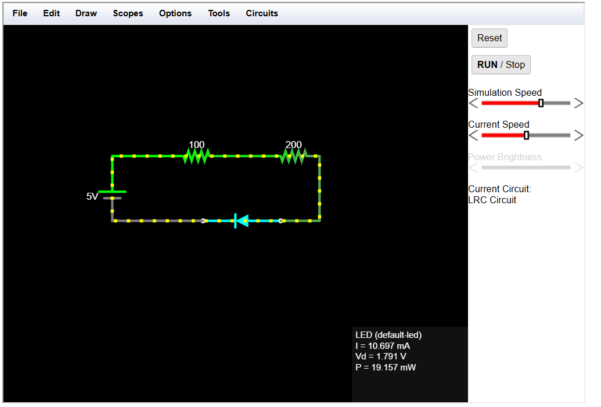
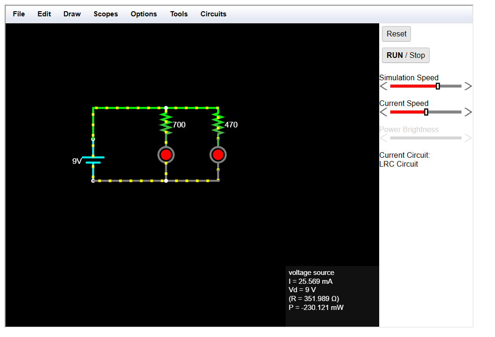
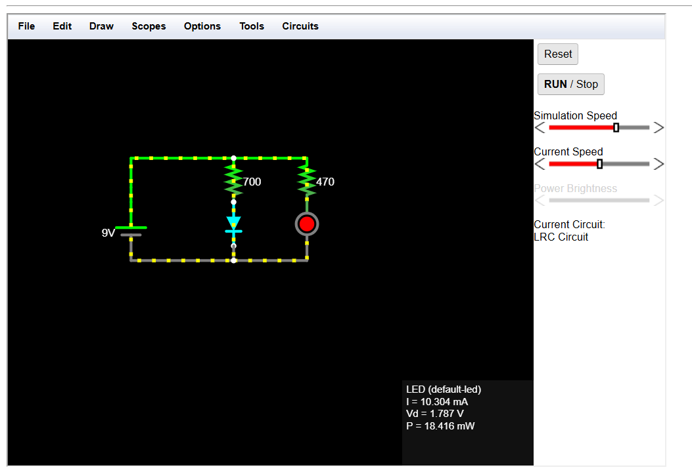
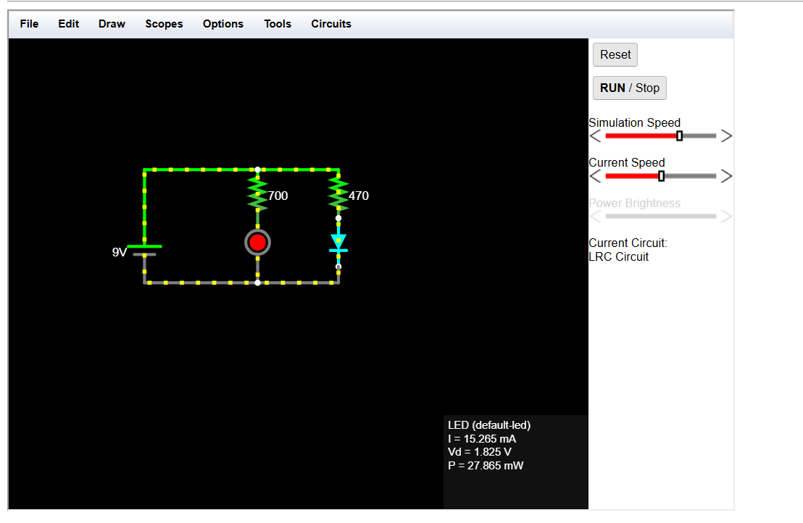
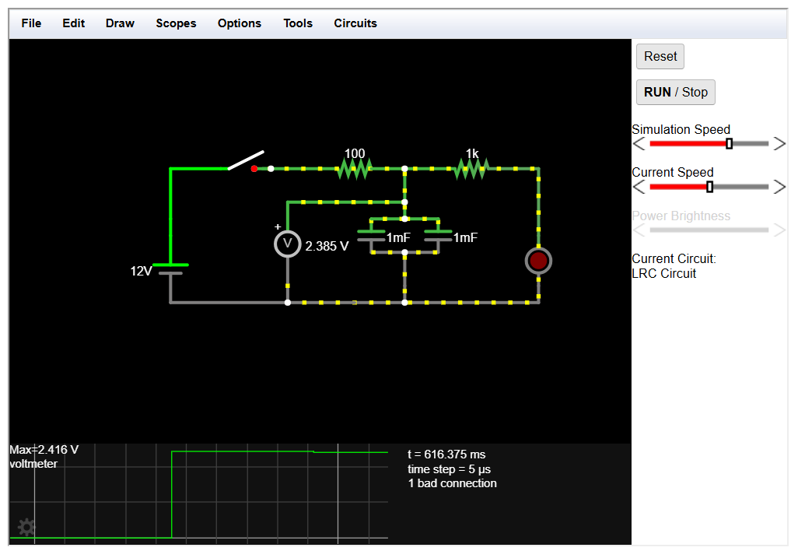
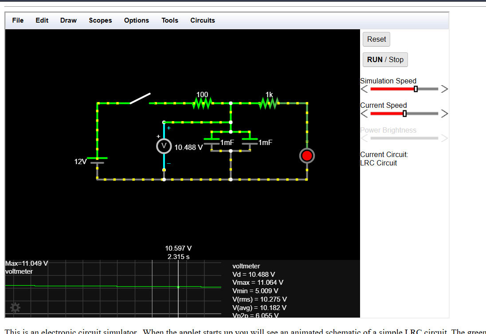
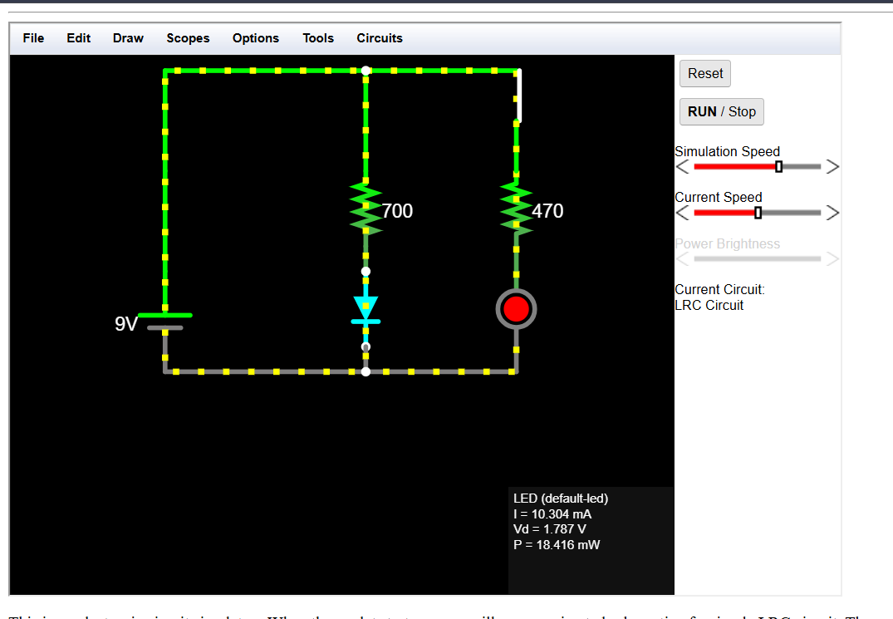
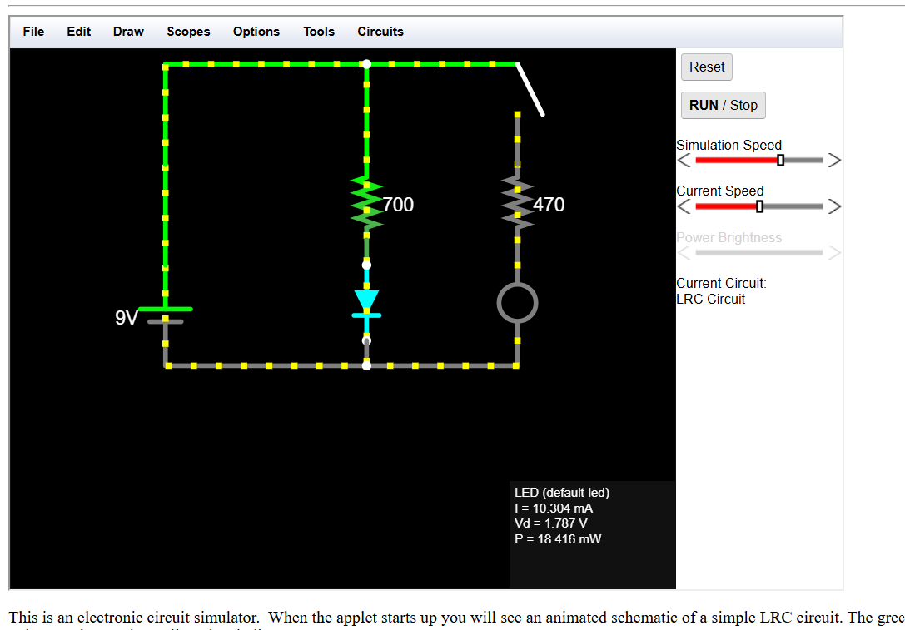
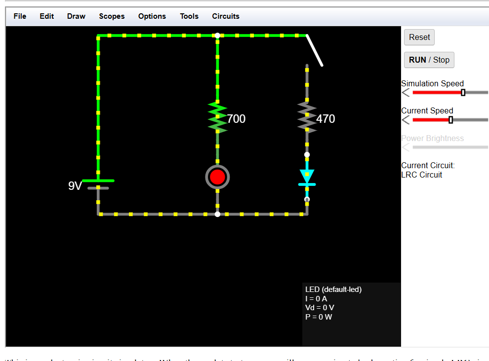

# Homework 2 – Basic Electrical Circuits

[⬅ Back to all homeworks](../README.md)

In this homework I built three circuits in the [Falstad Circuit Simulator](https://www.falstad.com/circuit/) and analysed each one twice: first **by hand**, using Ohm's law, Kirchhoff's laws and the RC charging/discharging equations, and then **in the simulator**. For every circuit I compare my calculated values with the simulated ones and explain where the differences come from.

| # | Circuit | What it does | Open in Falstad |
|---|---|---|---|
| 1 | [Series circuit (5 V)](#1-series-circuit-5-v-dc) | Two resistors and a red LED in one loop, sized for 10 mA | [▶ open](https://www.falstad.com/circuit/circuitjs.html?ctz=DwYwlgTgBAZgvAIgIwKgFwM6IAwDpsEECsqYIiSeATAVQOx0DM2AHFQGwCcndqIARoiLZUAB0EIALI1QA3CENQBbTEICmAWiQoAfAFgAUFCjBZUAB4V22KPSpQk1261Txk7VAHc3IqEoCG5rKKAPT6RibQlghUVJIOnPbM8UiJrjioCsgECGGGxsBRiIxE9qn2ko4JVOkIvlk0InkRwAAyAKIAIhbF7Cy2dPZ2AzWwGX4A9ogAJmow-gCuADZoGktq03xZKFAgAObjAuNK-OR1+CjNBZ49MXHVDk7ltU3h17eONsPfgy+5byYbtFGH0RlBKuwRn8roDbhCHvC7NCAcAgcVSg9ktVkflYdFPg8CTQWDiDMAQuAIOEgA) |
| 2 | [Parallel circuit (9 V)](#2-parallel-circuit-9-v-dc) | Two resistor + LED branches carrying different currents (10 mA and 14.89 mA) | [▶ open](https://www.falstad.com/circuit/circuitjs.html?ctz=DwYwlgTgBAZgvAIgIwKgFwM6IAwDpsEECsqYIiSeATAVQOx0DM2AHFQGwCcndqIARoiLZUAB0EIALI1QA3CENQBbTEICmAWiQoAfAFgAUFCjBZUAB4V22KPSpQk1261Txk7VAHc3IqEoCG5rKInAgA9PpGJp4WVjY0LA5OSJKSrjjhkcbAMZbuNimStiyJhekIIhGG2bmIVCUOqVCMLEVlsBlVUcDQefWlTf0OnFTlvgoIdASZ1dGxCENII8WJCWMz3QAyAKIAIvNDCSu2RB4dFcoA9ogAJmow-gCuADZoGs9qN3wTKFAgAOYZP4SXxKfjkCr4FBdGoHBpUU7HOzrGEmXqIFptJqY4ajc7jRCSKYbWF5HFLew4tb4kkmHb7MmtZyJKmndZ+a4IO4PF5vD5fP4-PiAi7AoFgiF4bDQrJzRlFBHsZpM5E01E5eaOeJ0eyHHUo2UavrwnXKhX6tWRYBhcAQHRAA) |
| 3a | [RC circuit (12 V), capacitors in series](#3-rc-circuit-12-v-dc) | Push button charges the capacitors; on release the LED fades out | [▶ open](https://www.falstad.com/circuit/circuitjs.html?ctz=DwYwlgTgBAZgvAIgIwKgFwM6IAwDpsEECsqYIiSeATAVQOx0DM2AHFQGwCcndqIARoiLZUAB0EIALI1QA3CENQBbTEICmAWiQoAfAFgAUFCjBZUAB4V22KPSpQk1261Txk7VAHc3IqEoCG5rIUVAgA9PpGJp4WVjZInPaONjQsrjjhkcbAGLEIqQ6SkrZE7IWS6Qi+ohTKSohoEACuapmG2dCWCIw05VCMRElFlb4KyARtUcCdiNJDxZLsxUjDsBlQY5QTEe0mADIAogAieURI9gVnF6UjygD2iAAmajD+TQA2aBrvao98m3wAObrATrJT8chVfAoHZTEB5RgsZZ0MqI4qpW5QSF4AgoKBgYJQ3GoDBjXyyR6IRj4KhUTiSM5EAasRKSUKw7Lwrpo2xUYo8qg3NZVPg4fDYPEEsXEqCk9YUqnQojK7g9FgMLiTbIxLqCsorfm9A23DnRBGDPo843CkSm4A6qlIvpzcomrJm7lOpAo-pe1Y+LUe2ZLPpXV02wP207nUMxjERu0OhBhvVQFN0UIJ91RrrJWwZ-qMMp2N27HOO9EF9OZgOJhFO1MCjOlqZJvMJJJOa217NtrtFZwscM9stJgWsX3ovkt7UIov5+xNmsZO2iOf6xKF4vN4UyPxqdYYbGoCAH8aEQiRsden2MefejxZ0frhy3++JGdB-KlPp8+L+ldszuKA1AAO0QWkSRqBAlkqcxM2gkR3WyNdCV8I8INtbMwjuSJgDCcAIEiIA) |
| 3b | [RC circuit (12 V), capacitors in parallel](#3-rc-circuit-12-v-dc) | Same circuit, 4× larger capacitance, so it charges and fades 4× slower | [▶ open](https://www.falstad.com/circuit/circuitjs.html?ctz=DwYwlgTgBAZgvAIgIwKgFwM6IAwDpsEECsqYIiSeATAVQOx0DM2AHFQGwCcndqIARoiLZUAB0EIALI1QA3CENQBbTEICmAWiQoAfACgoUYLKgAPCu2xR6VKEkvXWqeMnaoA7i5FQlAQ1OyFFQIAPT6hsDuZhZWSJy29lY0LM44oeFG0OYIjDR2kpJQjEQJBakI3grIBOkGmdFSufmFkuyFSGWwaVBVlDVhdcAAMgCiACINREi2yVBTM0RuXRXKAPaIACZqML4ArgA2aBr7aht8vXwA5t0C3Ur85BX4KAMRIA3FCfFFJdZUkuVvI88AQUFAwIEnqDUBgqt5ZBs0q8jO9spJ7HZvuj2H8AcsgTh8NgwRDCdCoLDugikRlIg0qItmkU8h08V5ahEotlPkzGCx2p12ci6dz+UzpKU2TTBlzEHz2nQcfLmoCOUZZVI2kz5ir8WqRUJptqjclVcKNTqGTjLXRgnrzQ1EtZbc6ZrazbSNcqbHMTe77Z6PmKrUVg-6hYHsk64gkHKyPTLHXGCo4WLqI4nuYwcT7veHpRFRPSXUhFa7rItyjIfGpuhhgagILXqoRCPqvb8Y6H2vEE5ygz3bNjMXaM-3RQqlWKY331R9flR-t3cbODTlg0vh4upSsHRPccurauNT7S1PJ8fi27bIxs67L9kfSGn-nd7SMPTWEyQ-G9VBRBQyhKIgaAQLsaj6qsUBqAAdogNAwgBCBtOUph2khIgZIWUCQt49bwSIwohKs+jACE4AQPoQA) |
| ★ | [Bonus: parallel circuit with a switch](#bonus-parallel-circuit-with-a-switch) | A switch in branch 2 turns LED2 on/off without affecting LED1 | [▶ open](https://www.falstad.com/circuit/circuitjs.html?ctz=DwYwlgTgBAZgvAIgIwKgFwM6IAwDpsEECsqYIiSeATAVQOx0DM2AHFQGwCcndqIARoiLZUAB0EIALI1QA3CENQBbTEICmAWiQoAfAFgAUFCjBZUAB4V22KPSpQk1261Txk7VAHc3IqEoCG5rKInAgA9PpGJp4WVjY0LA5OSJKSrjjhkcbAMZbuNizxLImF6QgiEYbZ0HlUxQ6ptvVInFRlvgoIdASZVdGxCHWJLfZDziztvVHAADIAogAiA2MJTYlURB6wGX4A9ogAJmow-gCuADZoGudqB3ydKFAgAOY7AjtK-OTl+CiV07lECtNmtbHQ2ttylNqgNGCxJA0EXCESNJlBOpJutD+nlkQ5WlA8QlJv9svMlrj4eNCVSNlsfMp9ggjicLlcbncng8+K8oU8JL5Pt88Ng-lkcYgiSCieCSeKcgNHPFwaC7HK+gravU7DSEWrIRV5YD8lBCkkbCk0gbsZqgfUzWNLeqAct7TY8aVraSTBhYVSzXjtBCGVBRBQbcbA0h7IHUs7gGFwBBIkA) |

My handwritten calculations and schematics are in [`handwritten_calculations.pdf`](handwritten_calculations.pdf).

## Contents

- [Files in this folder](#files-in-this-folder)
- [Formulas used](#formulas-used)
- [1. Series Circuit (5 V DC)](#1-series-circuit-5-v-dc)
- [2. Parallel Circuit (9 V DC)](#2-parallel-circuit-9-v-dc)
- [3. RC Circuit (12 V DC)](#3-rc-circuit-12-v-dc)
- [Bonus: Parallel Circuit with a Switch](#bonus-parallel-circuit-with-a-switch)
- [Acknowledgments](#acknowledgments)

## Files in this folder

| File | Content |
|---|---|
| [`series_circuit.txt`](series_circuit.txt) | Exercise 1 – Falstad export |
| [`parallel_circuit.txt`](parallel_circuit.txt) | Exercise 2 – Falstad export |
| [`rc_series.txt`](rc_series.txt) | Exercise 3 – RC circuit, capacitors in series |
| [`rc_parallel.txt`](rc_parallel.txt) | Exercise 3 – RC circuit, capacitors in parallel |
| [`parallel_circuit_switch.txt`](parallel_circuit_switch.txt) | Bonus – parallel circuit with a switch in branch 2 |
| [`handwritten_calculations.pdf`](handwritten_calculations.pdf) | All calculations and schematics, done by hand |
| [`images/`](images/) | Screenshots of each circuit running in Falstad |

**To open a circuit:** click the **▶ open** link in the table above, or in Falstad go to **File → Import From Text** and paste the contents of a `.txt` file.

## Formulas used

| Law | Formula |
|---|---|
| Ohm's law | $V = I \cdot R$ |
| Power | $P = V \cdot I = I^2 R = V^2 / R$ |
| KVL (around a loop) | $\sum V_{drops} = V_{source}$ |
| KCL (at a node) | $I_{in} = \sum I_{out}$ |
| Resistors in series / parallel | $R_{eq} = R_1 + R_2$ / $R_{eq} = \dfrac{R_1 R_2}{R_1 + R_2}$ |
| Capacitors in parallel / series | $C_{eq} = C_1 + C_2$ / $C_{eq} = \dfrac{C_1 C_2}{C_1 + C_2}$ |
| RC time constant | $\tau = R \cdot C$ |

> **Assumption:** I used **2 V** as the forward voltage of a red LED to keep the calculations simple. A real red LED is closer to 1.8 V, and Falstad's default LED model drops about **1.79–1.83 V**. This explains most of the small differences between theory and simulation below.

---

## 1. Series Circuit (5 V DC)

A single loop: 5 V source → R1 → R2 → red LED → back to the source. Since there is only one path, the same current flows through every component, and the source voltage is shared between the resistors and the LED.

### Design

Target current: **I = 10 mA** (inside the required 5–20 mA range).

By KVL, the source voltage is split between the LED and the two resistors:

$$V_s = V_{LED} + V_{R1} + V_{R2} \ \Rightarrow\ V_{R1} + V_{R2} = 5 - 2 = 3\ \text{V}$$

I chose $V_{R1} = 1$ V and $V_{R2} = 2$ V, then used Ohm's law with $10\ \text{mA} = 1 \cdot 10^{-2}$ A:

$$R_1 = \frac{1\ \text{V}}{1 \cdot 10^{-2}\ \text{A}} = 100\ \Omega \qquad R_2 = \frac{2\ \text{V}}{1 \cdot 10^{-2}\ \text{A}} = 200\ \Omega$$

### Analysis

$$I = \frac{V_s - V_{LED}}{R_1 + R_2} = \frac{5 - 2}{300} = 10\ \text{mA}$$

| Component | Voltage | Power ($P = V \cdot I$) |
|---|---|---|
| R1 = 100 Ω | 1 V | 10 mW |
| R2 = 200 Ω | 2 V | 20 mW |
| LED | 2 V | 20 mW |
| Source | 5 V | 50 mW delivered |

- **KVL check:** $1 + 2 + 2 = 5$ V ✅
- **Energy check:** $10 + 20 + 20 = 50$ mW = power delivered by the source ✅

**Observation:** the bigger resistor heats up more. The current is the same through both, and $P = I^2 R$, so double the resistance means double the heat: R2 (200 Ω) dissipates twice as much as R1 (100 Ω).

### Theory vs. simulation

| Quantity | Theory | Falstad |
|---|---|---|
| Current I | 10 mA | 10.697 mA |
| V_LED | 2 V | 1.791 V |
| V_R1 | 1 V | 1.070 V \* |
| V_R2 | 2 V | 2.139 V \* |
| P_R1 | 10 mW | 11.44 mW \* |
| P_R2 | 20 mW | 22.88 mW \* |
| P_LED | 20 mW | 19.157 mW |

\* calculated from the simulated current with Ohm's law.

KVL also holds in the simulation: $1.070 + 2.139 + 1.791 = 5.000$ V ✅

**Why the difference:** Falstad's LED drops 1.791 V instead of the assumed 2 V, so more voltage is left for the resistors and the current is slightly higher. Recalculating with the simulated LED voltage gives $\frac{5 - 1.791}{300} = 10.697$ mA, exactly the simulated value.

---

## 2. Parallel Circuit (9 V DC)

Two branches connected across the 9 V source, each with its own resistor and red LED. In parallel every branch gets the full source voltage (9 V), each branch has its own current, and the branch currents add up to the total current drawn from the source (KCL). KVL still applies inside each branch: $V_s = V_R + V_{LED}$.

| LED1 (700 Ω branch) | LED2 (470 Ω branch) |
|---|---|
|  |  |

### Design

KVL in each branch: $V_R = V_s - V_{LED} = 9 - 2 = 7$ V across both resistors.

Target currents: 10 mA and 15 mA.

$$R_1 = \frac{7\ \text{V}}{10 \cdot 10^{-3}\ \text{A}} = 700\ \Omega \qquad R_2 = \frac{7\ \text{V}}{15 \cdot 10^{-3}\ \text{A}} \approx 466.7\ \Omega$$

For R2 I used the nearest standard value, **470 Ω**, and recalculated the current.

### Analysis

$$I_1 = \frac{9 - 2}{700} = 10\ \text{mA} \qquad I_2 = \frac{9 - 2}{470} = 14.89\ \text{mA}$$

**KCL:** $I_{total} = I_1 + I_2 = 10 + 14.89 = 24.89$ mA

**Check with the equivalent resistance** (valid because both resistors have the same 7 V across them):

$$R_{eq} = \frac{700 \cdot 470}{700 + 470} = \frac{329000}{1170} \approx 281.2\ \Omega \qquad I_{total} = \frac{7}{281.2} = 24.89\ \text{mA}\ ✅$$

$R_{eq}$ is smaller than both resistors: each extra branch gives the current another path.

| Component | Voltage | Current | Power |
|---|---|---|---|
| R1 = 700 Ω | 7 V | 10 mA | 70 mW |
| R2 = 470 Ω | 7 V | 14.89 mA | 104.3 mW |
| LED1 | 2 V | 10 mA | 20 mW |
| LED2 | 2 V | 14.89 mA | 29.8 mW |
| Source | 9 V | 24.89 mA | 224.0 mW delivered |

- **KVL per branch:** $7 + 2 = 9$ V ✅ for both branches
- **Energy check:** $70 + 104.3 + 20 + 29.8 \approx 224$ mW ✅

**Observation:** in parallel the voltage is the same on each branch, so because $P = V^2 / R$ the **smaller** resistor draws more current and dissipates more power. This is the opposite of the series circuit, where the current was the same and the larger resistor dissipated more.

### Theory vs. simulation

| Quantity | Theory | Falstad |
|---|---|---|
| I1 (LED1) | 10 mA | 10.304 mA |
| I2 (LED2) | 14.89 mA | 15.265 mA |
| I_total | 24.89 mA | 25.569 mA |
| V_LED1 / V_LED2 | 2 V / 2 V | 1.787 V / 1.825 V |
| P_R1 | 70 mW | 74.32 mW \* |
| P_R2 | 104.3 mW | 109.53 mW \* |
| P_LED1 / P_LED2 | 20 / 29.8 mW | 18.416 / 27.865 mW |
| P_source | 224.0 mW | 230.121 mW |

\* calculated from the simulated LED voltages and currents ($V_R = 9 - V_{LED}$).

**KCL in the simulation:** $10.304 + 15.265 = 25.569$ mA ✅, exactly the source current.

**Notes:**
- The currents are slightly higher than in theory for the same reason as in Exercise 1: the simulated LEDs drop less than 2 V.
- The two LEDs have different voltages (1.787 V vs 1.825 V): an LED's forward voltage rises slightly with current, and LED2 carries more current.
- Falstad shows the source power as negative (−230.121 mW). That is a sign convention meaning the source delivers power instead of consuming it.

---

## 3. RC Circuit (12 V DC)

### How it works

- **Button pressed:** the 12 V source charges the capacitors through the small charging resistor $R_c$. The LED is on.
- **Button released:** the source is disconnected. The capacitors now act as the "battery" and discharge through the discharging resistor $R_d$ and the LED. As the capacitor voltage drops, the LED current drops too, so the LED **fades out gradually** instead of turning off instantly.

I built the same circuit twice, with the two capacitors **in series** and **in parallel**. A voltmeter with a scope is connected across the whole capacitor block to record its voltage over time.

| Capacitors in series | Capacitors in parallel |
|---|---|
|  |  |

### Component values

| Component | Value | Why |
|---|---|---|
| Source | 12 V | required |
| R_c (charging) | 100 Ω | limits the inrush current when the button is pressed (an empty capacitor initially acts like a short circuit: max 12 V / 100 Ω = 120 mA instead of an almost unlimited spike), and gives charging a measurable time constant |
| R_d (discharging) | 1000 Ω | protects the LED: right after release the LED current is at most about (12 − 2) / 1000 = 10 mA, below 20 mA. It is 10× R_c, so charging is fast and the fade is slow |
| C1 = C2 | 1000 µF = 1·10⁻³ F | a common value that gives a fade long enough to see |
| LED | red, ≈ 2 V | |

### Maximum capacitor voltage

While the button is held and the capacitors are full, no current flows into them, so the circuit reduces to one loop: 12 V → R_c → R_d → LED.

$$I = \frac{V_s - V_{LED}}{R_c + R_d} = \frac{12 - 2}{100 + 1000} = \frac{1}{110}\ \text{A} \approx 9.09\ \text{mA}$$

$$V_{max} = V_s - I \cdot R_c = 12 - 0.909 \approx 11.09\ \text{V}$$

Falstad: **11.067 V** (series) and **11.064 V** (parallel). $V_{max}$ is the same for both because $C$ does not appear in this calculation: the resistors and the source decide *where* the voltage ends up, the capacitance only decides *how fast* it gets there. (With the simulated LED voltage of 1.8 V the formula gives 11.07 V, almost exactly the simulation.)

### Equivalent capacitance and time constants

Charging goes through R_c and discharging through R_d, so there are two time constants: $\tau_c = R_c \cdot C_{eq}$ and $\tau_d = R_d \cdot C_{eq}$.

| | Series | Parallel |
|---|---|---|
| $C_{eq}$ | $\frac{1000 \cdot 1000}{1000 + 1000} = 500$ µF | $1000 + 1000 = 2000$ µF |
| $\tau_c = 100\ \Omega \cdot C_{eq}$ | 0.05 s | 0.2 s |
| $\tau_d = 1000\ \Omega \cdot C_{eq}$ | 0.5 s | 2 s |
| Full charge ≈ $5\tau_c$ | 0.25 s | 1 s |

**Comparison:**
- $\tau_{parallel} / \tau_{series} = 4$ (both for charging and discharging). The resistors are the same, so τ depends only on $C_{eq}$: with equal capacitors, parallel gives $2C$ and series gives $C/2$, which is 4 times smaller. So the parallel version charges and fades out 4 times slower.
- $\tau_d / \tau_c = 10$ in both versions. $C_{eq}$ is the same, so τ depends only on R, and $R_d / R_c = 10$. The capacitors charge 10 times faster than they discharge: even a short tap on the button charges them a lot (after $2\tau_c$ they are already at ~87%), while the fade after release is long and visible.

### Threshold time

Chosen threshold: **V_th = 6 V**, around the middle of the 0–11.09 V range and above the LED voltage (during discharge the capacitor voltage falls toward ≈ 2 V, not 0 V, because the LED stops conducting below its forward voltage).

| | Initial voltage | Target voltage |
|---|---|---|
| Charging | 0 V | 6 V |
| Discharging | 11.09 V | 6 V |

**Charging.** The capacitor voltage rises toward $V_{max}$:

$$V(t) = V_{max}\left(1 - e^{-t/\tau_c}\right) \ \Rightarrow\ t_{charge} = -\tau_c \ln\left(1 - \frac{V_{th}}{V_{max}}\right)$$

$$1 - \frac{6}{11.09} = 1 - 0.5410 = 0.4590 \qquad \ln(0.4590) \approx -0.7788$$

- Series ($\tau_c = 0.05$ s): $t = -0.05 \cdot (-0.7788) = 0.0389$ s ≈ **38.9 ms**
- Parallel ($\tau_c = 0.2$ s): $t = -0.2 \cdot (-0.7788) = 0.1558$ s ≈ **155.8 ms**

**Discharging.** By KVL around the discharge loop (capacitor → R_d → LED), $V_C = V_{R_d} + V_{LED}$, so $V_{R_d} = V_C - V_{LED}$ and only the part above the LED voltage decays exponentially:

$$V(t) - V_{LED} = (V_{max} - V_{LED})\, e^{-t/\tau_d} \ \Rightarrow\ t_{discharge} = \tau_d \ln\left(\frac{V_{max} - V_{LED}}{V_{th} - V_{LED}}\right)$$

$$\frac{11.09 - 2}{6 - 2} = \frac{9.09}{4} = 2.2725 \qquad \ln(2.2725) \approx 0.8209$$

- Series ($\tau_d = 0.5$ s): $t = 0.5 \cdot 0.8209 = 0.4104$ s ≈ **0.41 s**
- Parallel ($\tau_d = 2$ s): $t = 2 \cdot 0.8209 = 1.6418$ s ≈ **1.64 s**

> The textbook formula $V(t) = V_0 e^{-t/\tau}$ assumes the capacitor discharges to 0 V through a plain resistor. With an LED in the loop it would not match the simulation, because the voltage levels off near the LED's forward voltage.

### Results: theory vs. Falstad

| | Series: calculated | Series: Falstad | Parallel: calculated | Parallel: Falstad |
|---|---|---|---|---|
| Charging 0 → 6 V | 38.9 ms | 42.30 ms | 155.8 ms | 162 ms |
| Discharging 11.09 → 6 V | 0.410 s | 0.411 s | 1.64 s | 1.78 s |

The parallel times are about 4× the series times in both theory and simulation, because $C_{eq}$ is 4× bigger. All measurements are within about 9% of the calculations.

**Where the differences come from:**
- **Charging:** these times are only tens of milliseconds, so reading the exact moment the button was pressed on the scope adds a few ms of error, which is a large fraction of 40 ms. The formula also uses $\tau_c = R_c \cdot C_{eq}$ as an approximation: while charging, current also flows through R_d and the LED.
- **Discharging:** a real LED is not a perfect constant 2 V. As the current drops during the fade, the LED conducts less easily and acts like extra resistance in series with R_d, which slows the discharge slightly. The longer the fade (parallel version), the more this shows.

---

## Bonus: Parallel Circuit with a Switch

**What I changed:** I took the parallel circuit from [Exercise 2](#2-parallel-circuit-9-v-dc) and added a switch S between the top wire and R2 (470 Ω), so branch 2 (R2 + LED2) can be turned on and off.

**Question:** when branch 2 is off, what happens to LED1 and to the total current?

| Switch closed | Switch open |
|---|---|
|  |  |
| Both LEDs on, LED1 carries **10.304 mA** | LED2 off, LED1 still carries **10.304 mA** |

*Switch open: LED2 has I = 0 A, V = 0 V, so it is completely off.*

### Analysis

**Step 1 – switch closed.** Same circuit as Exercise 2:

$$I_1 = 10\ \text{mA} \qquad I_2 = 14.89\ \text{mA} \qquad I_{total} = 24.89\ \text{mA} \qquad R_{eq} = 281.2\ \Omega$$

**Step 2 – switch open, branch 2.** The switch is open, so branch 2 is not a closed loop: $I_2 = 0$ mA and LED2 is off.

**Step 3 – switch open, branch 1 (KVL).** Branch 1 is still connected directly across the source:

$$V_s = V_{R1} + V_{LED1} \ \Rightarrow\ 9 = V_{R1} + 2 \ \Rightarrow\ V_{R1} = 7\ \text{V (unchanged)}$$

$$I_1 = \frac{V_{R1}}{R_1} = \frac{7\ \text{V}}{700\ \Omega} = 10\ \text{mA (unchanged)}$$

**Step 4 – switch open, total current (KCL).**

$$I_{total} = I_1 + I_2 = 10\ \text{mA} + 0\ \text{mA} = 10\ \text{mA}$$

**Step 5 – switch open, equivalent resistance and power.** Only R1 is left, so $R_{eq} = 700\ \Omega$ (it was 281.2 Ω). Check: $I_{total} = \frac{7\ \text{V}}{700\ \Omega} = 10$ mA ✅

$$P_s = V_s \cdot I_{total} = 9\ \text{V} \cdot 10\ \text{mA} = 90\ \text{mW} \quad \text{(it was 224 mW)}$$

### Theory vs. simulation

| | Switch closed: theory | Switch closed: Falstad | Switch open: theory | Switch open: Falstad |
|---|---|---|---|---|
| I1 (LED1) | 10 mA | 10.304 mA | 10 mA | 10.304 mA |
| I2 (LED2) | 14.89 mA | 15.265 mA | 0 mA | 0 mA |
| I_total | 24.89 mA | 25.569 mA | 10 mA | 10.304 mA |
| R_eq | 281.2 Ω | – | 700 Ω | – |
| P_source | 224 mW | 230.121 mW | 90 mW | – |

With the switch open, the simulated source current (10.304 mA) is exactly the LED1 current, as KCL predicts when only one path is left. The small difference from 10 mA has the same cause as in Exercise 2: the simulated LED drops 1.787 V instead of 2 V.

### Conclusion

Opening the switch turns off only LED2. LED1 keeps exactly the same current (10.304 mA in Falstad, before and after), because its branch is still connected directly across the 9 V source: the branches of a parallel circuit work independently. Only the total current changes (KCL): it drops from 24.89 mA to 10 mA, because one path for the current has been removed.

In a series circuit (Exercise 1) this would be different: there is only one path, so opening a switch anywhere would stop the current everywhere and every component would turn off. (This is why the lights in a house are wired in parallel.)

---

## Acknowledgments

I used Claude (AI) to explain the theory and formulas, check my calculations, and help write this README. The circuit design, the choice of component values, the Falstad simulations and the measurements are my own.

[⬅ Back to all homeworks](../README.md)
