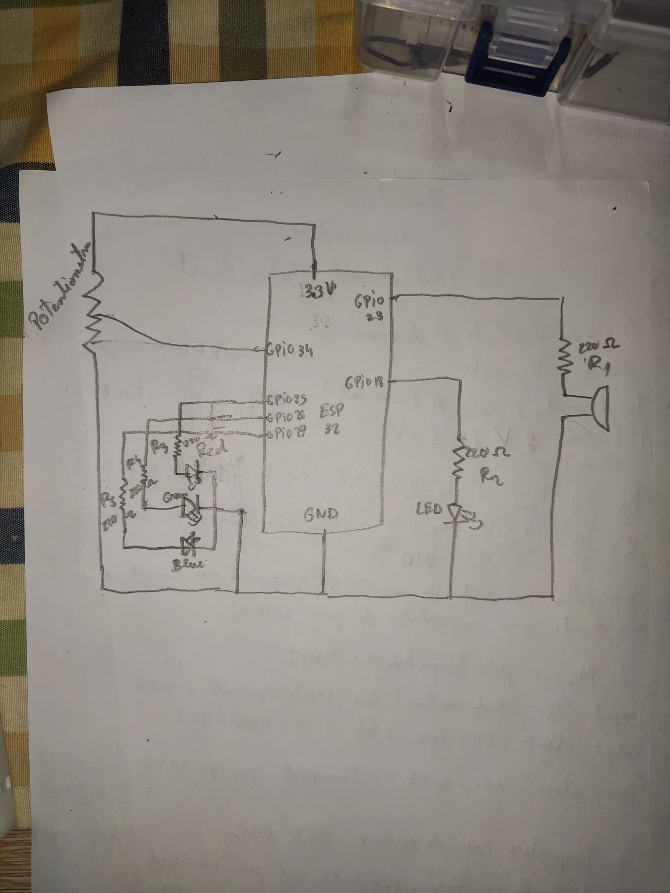
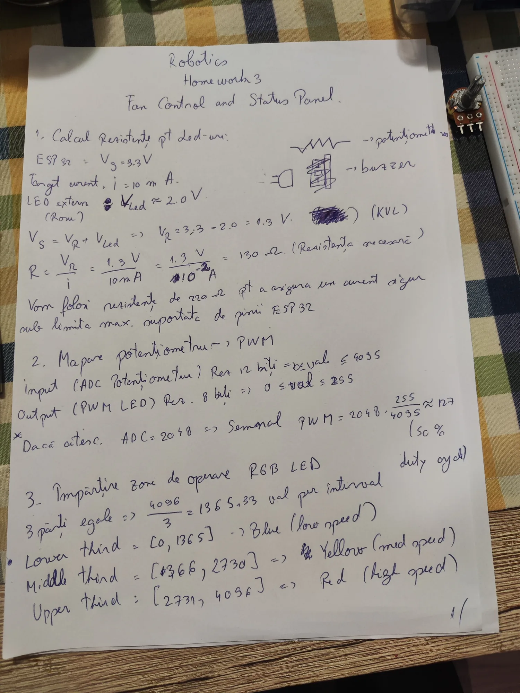
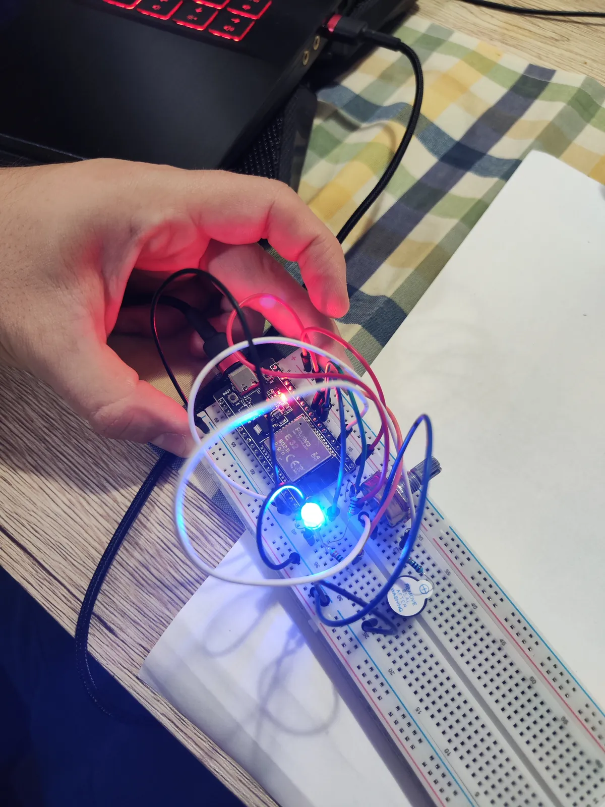
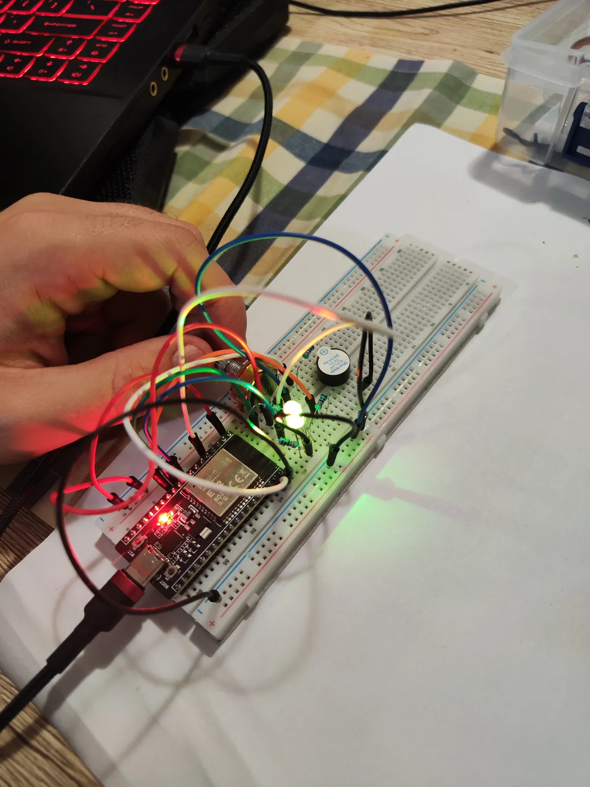
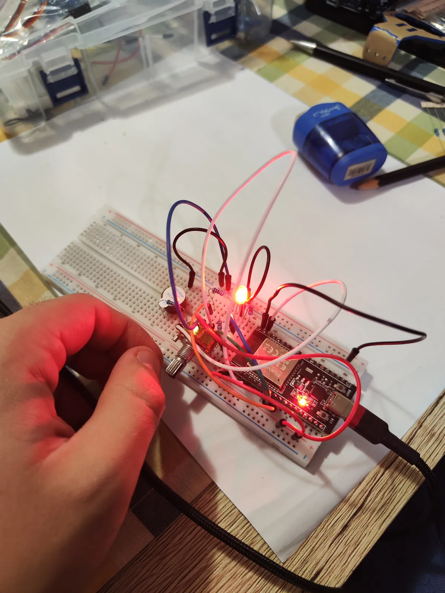
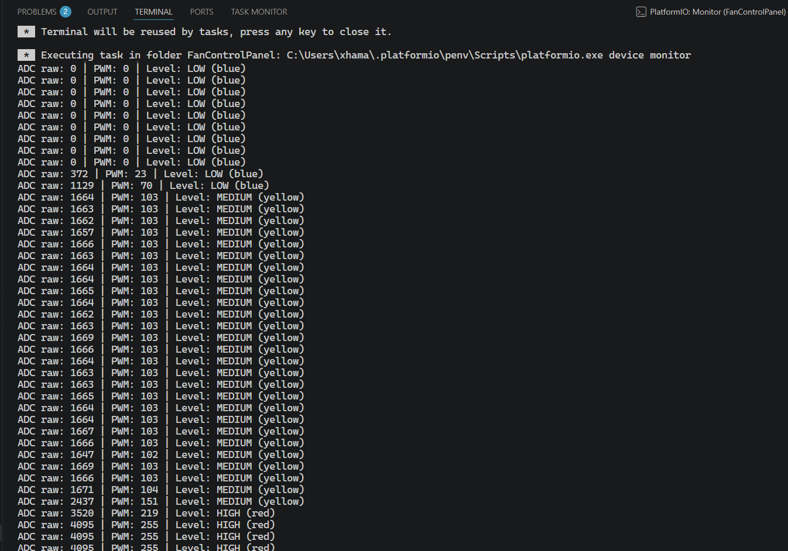

# Homework 3 – Fan Control and Status Panel

[⬅ Back to all homeworks](../README.md)

In this homework I built a simplified **ventilation control panel** on an ESP32. An operator turns a knob (potentiometer) to request a fan speed. The "fan" is simulated by an LED whose brightness follows the knob (PWM). An RGB LED shows the operating level (**blue / yellow / red**), a passive buzzer beeps once when the system enters the high level, and the on-board LED blinks as a **heartbeat** to show that the controller is alive. Everything runs without `delay()` in `loop()`, so all of these things happen at the same time.

| At a glance | |
|---|---|
| Board | ESP32 DevKit (ESP32-WROOM), Arduino framework, PlatformIO |
| Input | Rotary potentiometer (speed knob) on `GPIO34` |
| Outputs | External red LED ("fan"), RGB LED (status), passive buzzer (alert), built-in LED (heartbeat) |
| Key concepts | PWM (`analogWrite`), 12-bit ADC (`analogRead`), `map()`, RGB LED, edge detection, non-blocking timing with `millis()` / `micros()` |
| Code | [`FanControlPanel/src/main.cpp`](FanControlPanel/src/main.cpp) |
| Demo video | [▶ YouTube](https://youtube.com/shorts/8dTgRdgKis0) |

## Contents

- [Files in this folder](#files-in-this-folder)
- [Hardware and connections](#hardware-and-connections)
- [Schematic](#schematic)
- [Formulas used](#formulas-used)
- [Calculations](#calculations)
- [Implementation](#implementation)
- [Challenges and debugging](#challenges-and-debugging)
- [Theory vs. practice](#theory-vs-practice)
- [Demo](#demo)
- [How to build and upload](#how-to-build-and-upload)
- [Sources](#sources)
- [Acknowledgments](#acknowledgments)

## Files in this folder

| File / folder | Content |
|---|---|
| [`FanControlPanel/`](FanControlPanel/) | PlatformIO project (`platformio.ini`, `src/main.cpp`) |
| [`images/circuit/`](images/circuit/) | Photos of the assembled circuit at each operating level |
| [`images/schematic/`](images/schematic/) | My hand-drawn schematic |
| [`images/calculations/`](images/calculations/) | My handwritten calculations |
| [`images/serial-monitor/`](images/serial-monitor/) | Screenshots of the Serial Monitor output |
| [`images/lab-references/`](images/lab-references/) | Screenshots of the Laboratory 2 sections my code builds on |
| [`media/`](media/) | Demo video (the video itself is on [YouTube](https://youtube.com/shorts/8dTgRdgKis0)) |

---

## Hardware and connections

| Component | ESP32 pin | Notes |
|---|---|---|
| Built-in LED (heartbeat) | `GPIO2` | on the board, nothing to wire |
| External red LED (fan indicator) | `GPIO18` | in series with 220 Ω to GND |
| Potentiometer (speed knob) | `GPIO34` (wiper) | outer pins to **3V3** and GND (not 5 V – ESP32 pins are not 5 V tolerant). `GPIO34` is on ADC1 and is input-only |
| RGB LED, common cathode | R → `GPIO25`, G → `GPIO26`, B → `GPIO27` | one 220 Ω resistor per colour, common (longest) leg to GND |
| Passive buzzer | `GPIO23` | in series with 220 Ω, other leg to GND |

- All grounds are connected together (common reference).
- Wire colours: **black** = GND, **red** = 3V3, other colours = signals.

**Components:** ESP32 DevKit, breadboard, 1 red LED, 1 RGB LED (common cathode), 5 × 220 Ω resistors, 1 rotary potentiometer, 1 passive buzzer, jumper wires, USB cable.

## Schematic



---

## Formulas used

| Law | Formula |
|---|---|
| Ohm's law | $V = I \cdot R$ |
| KVL (LED + resistor in series) | $V_S = V_R + V_{LED}$ |
| Power | $P = I^2 \cdot R$ |
| ADC voltage | $V = raw \cdot \dfrac{3.3\ \text{V}}{4095}$ |
| ADC → PWM (`map()`) | $pwm = raw \cdot \dfrac{255}{4095}$ (integer result) |
| Duty cycle / average voltage | $D = \dfrac{pwm}{255}$, $V_{avg} = D \cdot 3.3\ \text{V}$ |
| Period | $T = \dfrac{1}{f}$ |

## Calculations

My handwritten calculations:



### 1. LED resistor

An ESP32 GPIO outputs $V_S = 3.3$ V. The recommended maximum current per pin is **12 mA** (absolute maximum ≈ 28 mA). Target current: **I = 10 mA**. Red LED: $V_F \approx 2.0$ V.

$$V_R = V_S - V_{LED} = 3.3 - 2.0 = 1.3\ \text{V} \qquad R_{min} = \frac{1.3\ \text{V}}{0.010\ \text{A}} = 130\ \Omega$$

**Chosen: 220 Ω** (the next value I had; rounding up keeps the current below the target).

$$I = \frac{1.3\ \text{V}}{220\ \Omega} = 5.91\ \text{mA} < 12\ \text{mA}\ ✅ \qquad P = (0.00591\ \text{A})^2 \cdot 220\ \Omega = 7.68\ \text{mW} \ll 250\ \text{mW}\ ✅$$

### 2. RGB LED at 3.3 V

The same 220 Ω resistor is used on each colour.

| Colour | $V_F$ | Current |
|---|---|---|
| Red | ≈ 2.0 V | $(3.3 - 2.0) / 220 = 5.91$ mA |
| Green, blue | ≈ 3.0–3.2 V (I used 3.1 V) | $(3.3 - 3.1) / 220 = 0.91$ mA |

**Conclusion:** at 3.3 V green and blue get about **6.5× less current** than red. Current alone does not decide how bright a colour looks, so the yellow mix (red + green) was tuned by eye: the final code uses full red and dimmed green (`yellowRedValue = 255`, `yellowGreenValue = 120`).

> [!NOTE]
> **Why one resistor per colour, not one shared resistor on the common leg?** After a shared resistor the three colours would be in parallel, so they would all get the same voltage. Red has the lowest $V_F$, so it would hold that voltage at about 2 V and take almost all the current. Green and blue would barely light, and the brightness would change depending on how many colours are on.

### 3. Buzzer series resistor

Worst case, with the pin HIGH:

$$I \le \frac{3.3\ \text{V}}{220\ \Omega} = 15.00\ \text{mA (peak)} \qquad \approx 7.50\ \text{mA average with the 50\% square wave}$$

Passive buzzers can have a very low coil resistance, so the resistor protects the GPIO. The cost is a quieter sound.

### 4. ADC (potentiometer)

- 12-bit ADC → values **0 … 4095** (4096 values).
- Resolution: $3.3\ \text{V} / 4095 = 0.81$ mV per step.
- Estimated pin voltage: $V = raw \cdot 3.3 / 4095$, e.g. raw 2048 → **1.65 V**.

### 5. Operating levels

The ADC range is split into thirds: $4096 / 3 = 1365.33$ values per third.

| Level | ADC range | RGB colour |
|---|---|---|
| Low speed | 0 – 1365 | 🔵 Blue |
| Medium speed | 1366 – 2730 | 🟡 Yellow |
| High speed | 2731 – 4095 | 🔴 Red |

### 6. PWM mapping (ADC → LED brightness)

PWM is 8-bit by default → values **0 … 255**.

$$pwm = raw \cdot \frac{255}{4095} \qquad raw = 2048 \Rightarrow 2048 \cdot \frac{255}{4095} = 127.53 \Rightarrow \texttt{map()}\ \text{gives}\ 127$$

$$D = \frac{127}{255} = 49.80\ \% \qquad V_{avg} = 0.4980 \cdot 3.3\ \text{V} = 1.64\ \text{V}$$

Level boundaries in PWM: raw 1365 → pwm **85**, raw 2730 → pwm **170**.

> [!NOTE]
> PWM does not output a real 1.64 V. The pin switches between 0 V and 3.3 V (default `analogWrite` frequency 1 kHz, period 1 ms), and the eye averages it into a dimmer light.

### 7. Timing

| What | Interval | Result |
|---|---|---|
| Heartbeat | toggles every 500 ms | period 1 s (1 Hz) |
| Serial debug | one line every 500 ms | 2 lines per second |
| Buzzer | 1 kHz tone for 500 ms | period $T = 1/1000\ \text{Hz} = 1000$ µs → pin toggled every **500 µs** (half period) |

---

## Implementation

The full code is in [`FanControlPanel/src/main.cpp`](FanControlPanel/src/main.cpp). `loop()` only calls functions, so it reads like a table of contents:

```cpp
void loop() {
  unsigned long currentMs = millis();
  updateHeartbeat(currentMs);
  updateFanSpeed();
  updateStatusColor();
  updateBuzzer(currentMs);
  printDebugInfo(currentMs);
}
```

| Requirement | Function in `main.cpp` | Idea |
|---|---|---|
| 1. Heartbeat | `updateHeartbeat()` | `millis()` pattern, no `delay()` |
| 2. Fan speed | `updateFanSpeed()` | `analogRead()` → `map()` 0–4095 → 0–255 → `analogWrite()` |
| 3. RGB status | `updateStatusColor()`, `setColor()` | `if / else if / else` on the thresholds, `enum FanLevel` |
| 4. Sound | `updateBuzzer()` | edge detection: beep only when *entering* the high level |
| 5. Non-blocking | whole `loop()` | no `delay()`, one time snapshot per loop |
| 6. Serial debug | `printDebugInfo()`, `getLevelName()` | prints ADC raw, PWM and level every 500 ms |

### 1. Heartbeat – `updateHeartbeat()`

If `currentMs − lastHeartbeatToggleMs ≥ heartbeatIntervalMs`, the function remembers the time, flips the state and writes the pin. Because it uses **subtraction** (not `currentMs ≥ last + interval`), it stays correct when `millis()` overflows after about 50 days.

### 2. Fan speed – `updateFanSpeed()`

Reads the potentiometer with `analogRead()` (0–4095), converts it with `map()` to 0–255 and writes it with `analogWrite()`. A higher knob position means a brighter LED, which stands for a faster fan.

### 3. RGB status – `updateStatusColor()`, `setColor()`

An `if / else if / else` on the two thresholds (`lowLevelMaxValue = 1365`, `mediumLevelMaxValue = 2730`). The branches are checked in order, so each one only needs the **upper** limit: if the first test failed, the value is already known to be above 1365. The level is stored in an `enum FanLevel { LOW_SPEED, MEDIUM_SPEED, HIGH_SPEED }` instead of magic numbers like 0/1/2. `setColor()` writes one PWM value per channel (common cathode: higher value = brighter).

### 4. Sound – `updateBuzzer()`

The buzzer must beep **once** when the system enters the high level, not continuously while it stays there. This is edge detection: compare the current level with the level from the previous loop.

```cpp
bool enteredHighSpeed = (fanLevel == HIGH_SPEED && previousFanLevel != HIGH_SPEED);
previousFanLevel = fanLevel;
```

When the edge is detected the beep starts. Then, on every loop, the pin is toggled every 500 µs using `micros()` until 500 ms have passed (see [Challenges](#challenges-and-debugging) for why I did not use `tone()`).

### 5. Non-blocking – whole `loop()`

There is no `delay()` anywhere. `millis()` is read **once** per loop and passed to every function, so all of them use the same time snapshot.

### 6. Serial debug – `printDebugInfo()`, `getLevelName()`

Every 500 ms it prints one line like `ADC raw: 2048 | PWM: 127 | Level: MEDIUM (yellow)` at 115200 baud.

### Code style

The code follows the course [Arduino style guide](https://github.com/Irikos/arduino-style-guide):

- a header comment describing the program and the circuit;
- constants and globals grouped at the top, with named pin constants (no magic numbers);
- descriptive camelCase names and a comment before each block;
- `setup()` / `loop()` first, helper functions after. Because PlatformIO compiles a `.cpp` file (not `.ino`), it does not generate function prototypes automatically, so they are declared before `setup()`.

---

## Challenges and debugging

- **Hardware first.** Before writing the final program I verified the hardware with a small diagnostic sketch that tested each output separately.
- **`tone()` did not work together with `analogWrite()`.** A standalone test with `tone()` beeped, but in the final program (4 pins on `analogWrite`) the buzzer was silent. On the ESP32 both use the LEDC PWM peripheral, so the conflict was most likely there. **Fix:** generate the square wave in software, toggling the buzzer pin every half period with `micros()`. It is the same non-blocking pattern as the heartbeat, only in microseconds.
- **Red and blue were swapped on the RGB LED.** A test sketch cycling red → green → blue showed the wrong order. I moved the **wires**, not the constants, because the assignment fixes R = `GPIO25` and B = `GPIO27`.
- **Getting a real yellow.** Based on [calculation 2](#2-rgb-led-at-33-v) I first reduced the red component of yellow to 60, but then red was not strong enough and the colour did not look yellow. Tuning by eye, I ended up with full red (255) and green reduced to 120.

## Theory vs. practice

| Test | Expected | Observed |
|---|---|---|
| ADC with the knob at minimum | ≈ 0 | 0 (PWM 0) |
| ADC with the knob at maximum | ≈ 4095 | 4095 (PWM 255) |
| ADC with the knob in the middle | ≈ 2048 (may differ, the potentiometer is not perfectly linear) | <!-- TODO: observed value --> |
| ADC noise with the knob still | small fluctuations | 1647 – 1671 around 1664 (PWM 102 – 104) |
| RGB colour per level | blue / yellow / red | <!-- TODO: observed --> |
| Beep when entering red | one single beep | <!-- TODO: observed --> |
| Heartbeat while turning the knob | keeps blinking at 1 Hz | <!-- TODO: observed --> |

Near the 2730 threshold the ADC noise can push the value back and forth across the limit, so the colour may flicker and the buzzer may beep again. The fix would be **hysteresis** (different thresholds for going up and going down). It is a possible bonus and is not implemented.

---

## Demo

### Video

[](https://youtube.com/shorts/8dTgRdgKis0)

<!-- TODO: watch the video once and confirm it really shows everything listed below -->
The video shows the whole circuit, the knob changing the LED brightness, the RGB LED going blue → yellow → red, the heartbeat still blinking, the beep when entering red, and the Serial Monitor output.

### Circuit

| Low speed (blue) | Medium speed (yellow) | High speed (red) |
|---|---|---|
|  |  |  |

### Serial Monitor

Turning the knob from minimum to maximum: the level goes LOW (blue) → MEDIUM (yellow) → HIGH (red), and the PWM value follows the ADC reading.



## How to build and upload

1. Open `Homework 3/FanControlPanel` in **VS Code** with the **PlatformIO** extension.
2. Click **Upload** (→ in the status bar).
3. Open the **Serial Monitor** at **115200 baud** (`monitor_speed = 115200` in [`platformio.ini`](FanControlPanel/platformio.ini)).

> [!TIP]
> If the upload hangs at `Connecting…`, hold the **BOOT** button on the ESP32 until it starts writing.

---

## Sources

The program combines patterns from **Laboratory no. 2**:

| Lab section | Pattern | Used in | Screenshot |
|---|---|---|---|
| §2.1 / §2.3 | Blinking the built-in and the external LED | `updateHeartbeat()` | [lab2-blink](images/lab-references/lab2-blink.webp) |
| §3.2 | Blinking without `delay()` using `millis()` | `updateHeartbeat()`, `updateBuzzer()`, `printDebugInfo()` | <!-- TODO: add images/lab-references/lab2-millis.webp --> |
| §4.2 | PWM with `analogWrite()` | `updateFanSpeed()`, `setColor()` | <!-- TODO: add images/lab-references/lab2-pwm.webp --> |
| §5.2 / §5.4 | Reading the potentiometer and `map()` | `updateFanSpeed()` | [lab2-potentiometer](images/lab-references/lab2-potentiometer.webp) |
| §6 | RGB LED (common cathode / common anode) and `setColor()` | `updateStatusColor()`, `setColor()` | [common cathode](images/lab-references/lab2-rgb.webp), [common anode](images/lab-references/lab2-rgb-common-anode.webp) |
| §7.2 | `tone()` (replaced in the end, see [Challenges](#challenges-and-debugging)) | `updateBuzzer()` | [lab2-tone](images/lab-references/lab2-tone.webp) |

From **Laboratory no. 1**: identifying common anode / common cathode RGB LEDs and the LED resistor calculation.

Code style: [Arduino style guide](https://github.com/Irikos/arduino-style-guide).

---

## Acknowledgments

I designed the circuit, did the calculations and the schematic, wired and tested the hardware (including finding the swapped RGB wires) and wrote the code myself. I used an AI assistant (Claude) as a tutor throughout: it explained the concepts, reviewed my calculations, schematic and code, and helped me debug and follow the recommended style. This README was drafted with AI help from my notes and checked by me.

[⬅ Back to all homeworks](../README.md)
