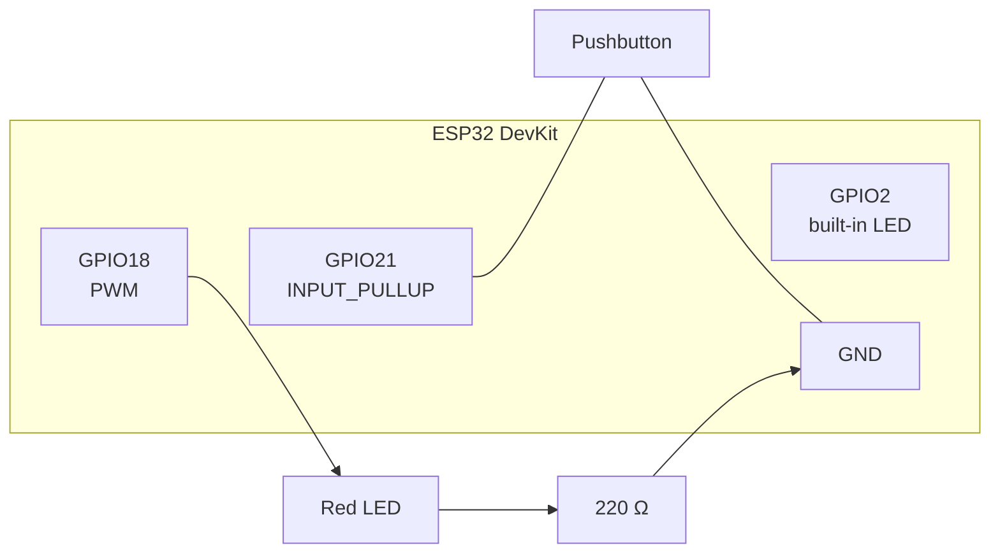
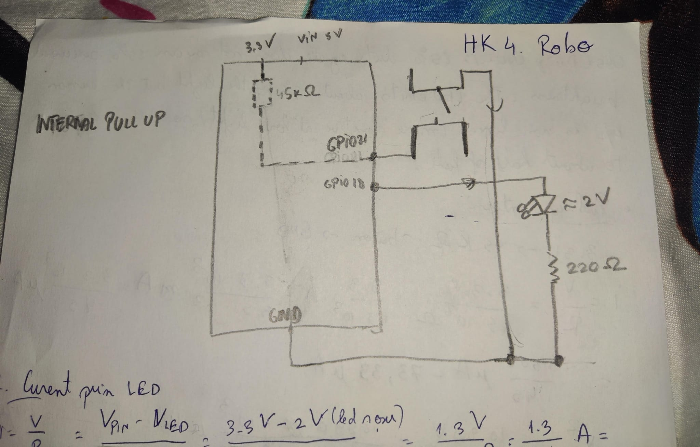
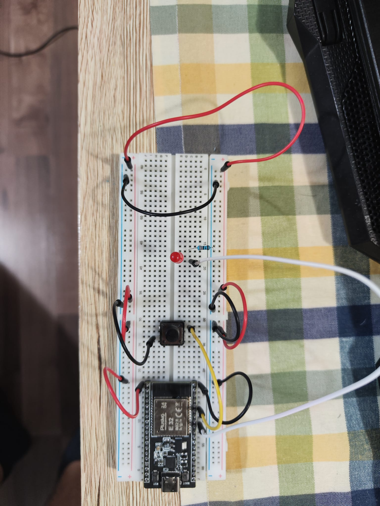
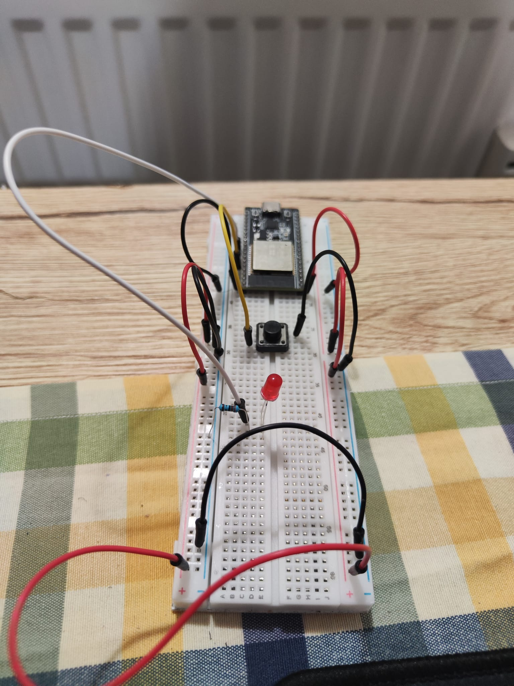
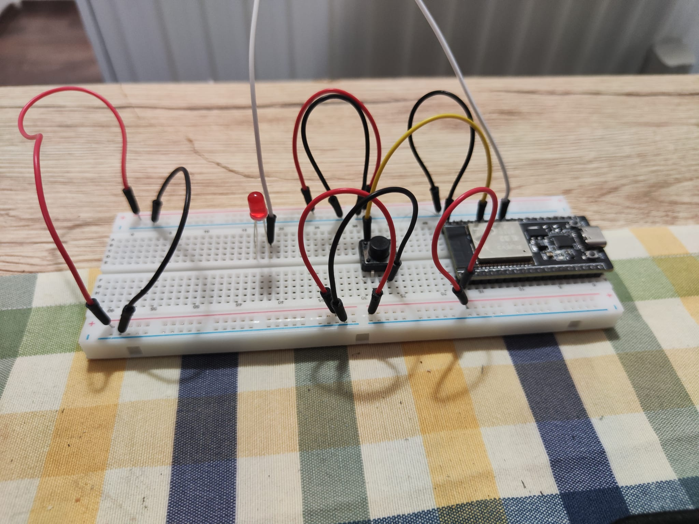
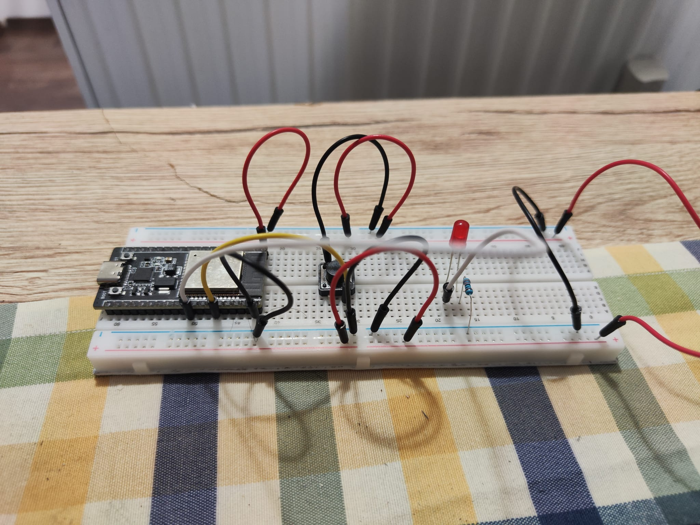
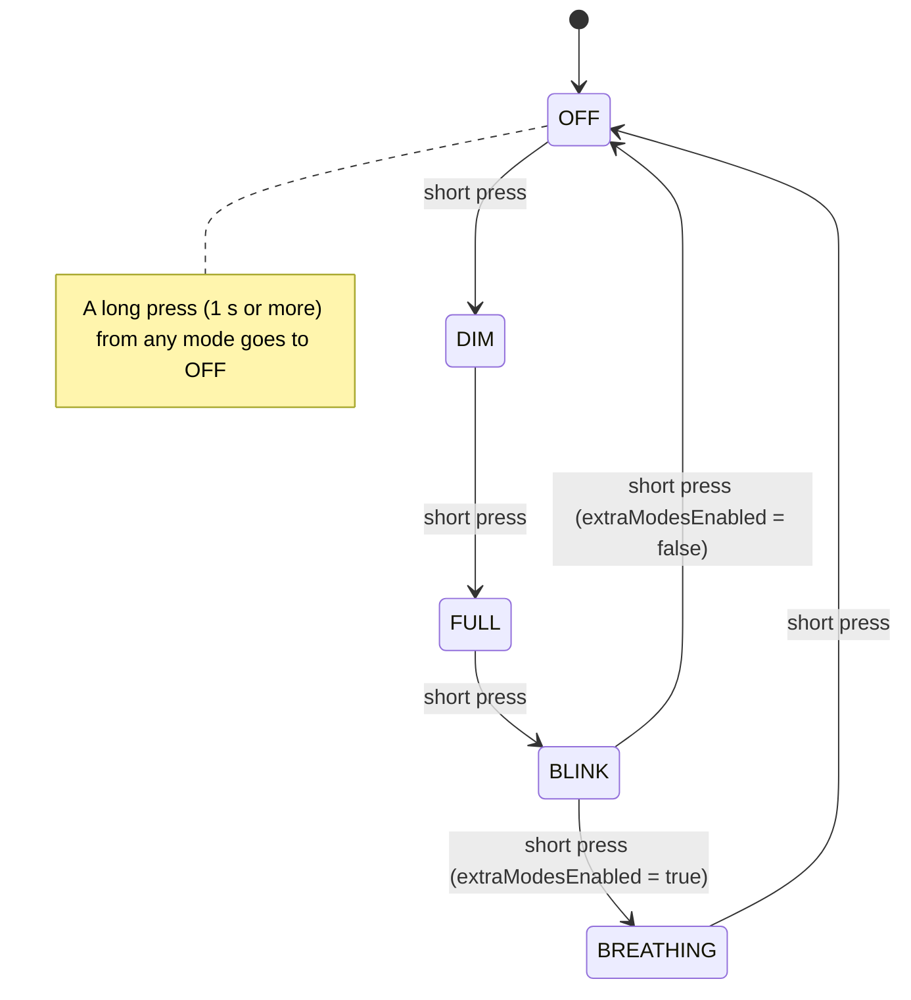
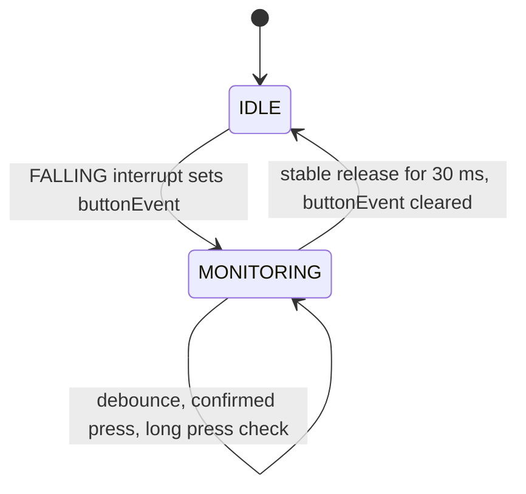
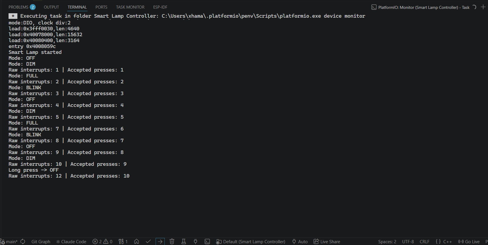
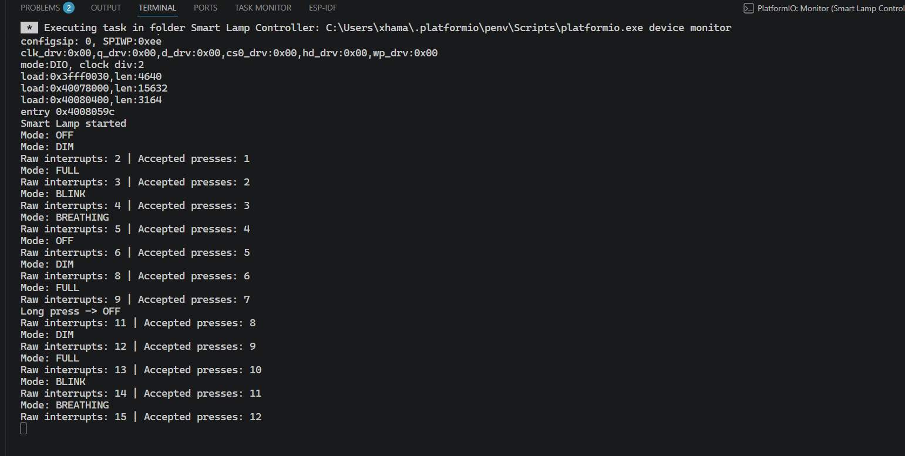

# Homework 4 – Smart Lamp Controller

[⬅ Back to all homeworks](../README.md)

One button, one lamp, and a controller that never stops listening.

In this homework I turned an ESP32, a red LED and a single pushbutton into a small **smart lamp**. Tap the button and the lamp moves to its next mode: **OFF → DIM → FULL → BLINK → BREATHING → OFF**. Hold it for a second and the lamp switches **off** right away, whatever it was doing. Meanwhile the board's built-in LED blinks steadily as a **heartbeat**, so you can always see that the program is alive.

The interesting part is the button itself. A real button doesn't make one clean contact. It *bounces*, and one press can look like several. Here an **interrupt** notices that something happened, and the program then checks in software whether it was a real press (**debouncing**). No `delay()` is used anywhere, so the lamp, the heartbeat and the button all work at the same time.

| At a glance | |
|---|---|
| Board | ESP32 DevKit (ESP32-WROOM), Arduino framework, PlatformIO |
| Input | Pushbutton on `GPIO21` (internal pull-up, active LOW, FALLING interrupt) |
| Outputs | Red LED "lamp" on `GPIO18` (PWM), built-in LED heartbeat on `GPIO2` |
| Key concepts | Modes with `enum`, PWM (`analogWrite`), debouncing, short vs. long press, external interrupts (`attachInterrupt`, `IRAM_ATTR`, `volatile`), non-blocking timing with `millis()` |
| Code | [`Smart Lamp Controller/src/main.cpp`](Smart%20Lamp%20Controller/src/main.cpp) |
| Demo video | [▶ YouTube](https://youtube.com/shorts/pWSBxM4EV-0) |

## Contents

- [Files in this folder](#files-in-this-folder)
- [Demo video](#demo-video)
- [Hardware and wiring](#hardware-and-wiring)
- [Calculations](#calculations)
- [How it works](#how-it-works)
- [Key design decisions](#key-design-decisions)
- [Theory vs. practice](#theory-vs-practice)
- [Problems I ran into](#problems-i-ran-into)
- [Serial Monitor](#serial-monitor)
- [How to build and upload](#how-to-build-and-upload)
- [Acknowledgments](#acknowledgments)

## Files in this folder

| File / folder | Content |
|---|---|
| [`Smart Lamp Controller/`](Smart%20Lamp%20Controller/) | PlatformIO project (`platformio.ini`, `src/main.cpp`) |
| [`images/`](images/) | Circuit photos, hand-drawn schematic, Serial Monitor screenshots |
| [`calculations/`](calculations/) | My handwritten calculations (PDF) |

---

## Demo video

<a href="https://youtube.com/shorts/pWSBxM4EV-0"></a>

In the video you can see, in order:

1. **The modes.** Short presses take the lamp through OFF → DIM → FULL → BLINK → BREATHING and back to OFF.
2. **Everything at once.** BLINK and the heartbeat keep their own rhythm, and the button still responds instantly.
3. **Short vs. long press.** Holding the button for about a second turns the lamp off from any mode. Letting go afterwards doesn't skip to another mode.
4. **The interrupts at work.** The Serial Monitor prints every mode change, plus how many raw interrupts arrived compared with how many presses were actually accepted.

> [!NOTE]
> The code is submitted with `extraModesEnabled = true`, so the bonus **BREATHING** mode comes after BLINK, exactly as in the video. Set it to `false` and the lamp runs only the mandatory OFF → DIM → FULL → BLINK → OFF cycle.

---

## Hardware and wiring

**Components:** ESP32 DevKit, breadboard, 1 pushbutton, 1 red LED, 1 × 220 Ω resistor, jumper wires, USB cable.

| Component | ESP32 pin | Connection |
|---|---|---|
| Pushbutton | `GPIO21` | `GPIO21` ↔ button ↔ GND. The internal pull-up (`INPUT_PULLUP`, about 45 kΩ) keeps the pin HIGH, and pressing pulls it **LOW** (active LOW) |
| Lamp (red LED) | `GPIO18` | `GPIO18` → LED anode, LED cathode → 220 Ω → GND. Driven with PWM |
| Heartbeat | `GPIO2` | the built-in LED, nothing to wire |

- Wire colours: **black** = GND, **red** = 3V3, **yellow / white** = signals.
- Watch out: my breadboard's power rails are **split at row 30**, so the two halves of each rail are not connected. I made sure GND actually reaches the half the LED is on. (I learned this the hard way, see [Problems](#problems-i-ran-into).)

### Wiring diagram

The same circuit as my schematic, drawn cleanly:



### Schematic and circuit

My hand-drawn schematic:



The assembled circuit from four angles:

| Top view | Looking along the board |
|---|---|
|  |  |
| **Side view (LED side)** | **Side view (ESP32 side)** |
|  |  |

---

## Calculations

The handwritten version is in [`calculations/handwritten_calc_hk4.pdf`](calculations/handwritten_calc_hk4.pdf).

### 1. How much current flows through the LED?

The GPIO gives 3.3 V, the red LED drops about $V_F \approx 2.0$ V, and the 220 Ω resistor takes the rest:

$$I = \frac{3.3\ \text{V} - 2.0\ \text{V}}{220\ \Omega} = \frac{1.3\ \text{V}}{220\ \Omega} = 5.91\ \text{mA}$$

That is comfortably below the **12 mA** recommended per ESP32 pin and inside the usual 5–20 mA range for an indicator LED. ✅

### 2. What does DIM really mean?

The lamp uses 8-bit PWM (0–255), and DIM writes `dimPwmValue = 64`:

$$D = \frac{64}{255} = 25.10\ \% \qquad V_{avg} = 0.2510 \cdot 3.3\ \text{V} = 0.83\ \text{V} \qquad I_{avg} = 0.2510 \cdot 5.91\ \text{mA} = 1.48\ \text{mA}$$

The pin never actually outputs 0.83 V. It flips between 0 V and 3.3 V so fast that the eye only sees the average.

### 3. The internal pull-up resistor

Inside the chip, `GPIO21` is tied to 3.3 V through about 45 kΩ:

| Button | Current | Power | Pin reads |
|---|---|---|---|
| Pressed (pin connected to GND) | $I = \dfrac{3.3\ \text{V}}{45\ \text{k}\Omega} = 73.33\ \mu\text{A}$ | $P = \dfrac{V^2}{R} = \dfrac{(3.3\ \text{V})^2}{45\ \text{k}\Omega} = 242.00\ \mu\text{W}$ | LOW |
| Released (open circuit) | $I \approx 0$ | $\approx 0$ | 3.3 V = HIGH |

So holding the button down costs almost nothing, and when it is released no current flows at all.

### 4. Timing

| What | Value in code | In seconds | Period / frequency |
|---|---|---|---|
| Debounce | `debounceDelayMs = 30` | 0.03 s | – |
| BLINK | `blinkIntervalMs = 500` (500 ms ON + 500 ms OFF) | 0.50 s per phase | $T = 1.00$ s, $f = 1.00$ Hz |
| Heartbeat | `heartbeatIntervalMs = 500` (toggles every 500 ms) | 0.50 s per phase | $T = 1.00$ s, $f = 1.00$ Hz |
| Long press | `longPressThresholdMs = 1000` | 1.00 s | – |

### 5. Bonus: one breath

BREATHING moves the brightness one PWM step every `breathingStepMs = 6` ms:

$$t_{up} = 255 \cdot 6\ \text{ms} = 1530\ \text{ms} \approx 1.53\ \text{s} \qquad t_{down} \approx 1.53\ \text{s}$$

$$T \approx 1.53 + 1.53 = 3.06\ \text{s} \qquad f = \frac{1}{3.06\ \text{s}} \approx 0.33\ \text{Hz}$$

About one slow breath every three seconds.

---

## How it works

The full code is in [`Smart Lamp Controller/src/main.cpp`](Smart%20Lamp%20Controller/src/main.cpp). `loop()` is short on purpose. It reads the time once and hands it to three independent jobs:

```cpp
void loop()
{
  unsigned long currentTime = millis();
  updateButton(currentTime);
  updateLamp(currentTime);
  updateHeartbeat(currentTime);
}
```

### Checkpoint 1 – Operating modes

The modes are an `enum LampMode { MODE_OFF, MODE_DIM, MODE_FULL, MODE_BLINK, MODE_BREATHING }`, and the current one lives in `currentMode`. `getNextMode()` picks the next mode, and `updateLamp()` uses a `switch` to make the lamp match it:

| Mode | What the lamp does |
|---|---|
| OFF | `analogWrite(lampPin, 0)` |
| DIM | `analogWrite(lampPin, 64)` |
| FULL | `analogWrite(lampPin, 255)` |
| BLINK | alternates between 255 and 0 every 500 ms |
| BREATHING (bonus) | fades smoothly between 0 and 255 |

**Why does the mode change when you release the button, not when you press it?**

- One press means exactly **one** mode change, however long the button is held.
- When the button goes down, the program can't know yet whether this will be a short tap or a long hold. It only knows at the release, and that is what makes Checkpoint 3 possible.

The lamp pin is written **only with `analogWrite`**, never with `digitalWrite` (the reason is in [Problems](#problems-i-ran-into)).



### Checkpoint 2 – Doing several things at once

BLINK and the heartbeat each keep **their own state and their own clock**:

| Behaviour | State | Timestamp | Interval |
|---|---|---|---|
| BLINK | `blinkLampOn` | `lastBlinkToggleTime` | `blinkIntervalMs` |
| Heartbeat | `heartbeatOn` | `lastHeartbeatToggleTime` | `heartbeatIntervalMs` |

On every pass through `loop()`, each one asks: *has my interval passed since the last toggle?* (`currentTime - lastToggleTime >= interval`). If yes, it saves the time and flips its state. If not, it does nothing and lets the others run. Since nothing ever waits with `delay()`, the button is checked thousands of times per second and the heartbeat keeps going in every mode.

One detail: when the lamp **enters** BLINK, `onConfirmedRelease()` sets `blinkLampOn = true` and restarts `lastBlinkToggleTime`. That way BLINK always starts with a full ON phase instead of a random half-finished one.

### Checkpoint 3 – Short vs. long press

1. When a debounced **press** is confirmed, `onConfirmedPress()` notes the time in `pressStartTime` and sets `longPressHandled = false`.
2. While the button is being watched, `checkLongPress()` runs on **every** loop, not only when something changes. That matters because a long press is defined by nothing happening for a whole second. Once `buttonState == LOW && !longPressHandled` and 1000 ms (`longPressThresholdMs`) have passed, it switches the lamp to OFF, prints `Long press -> OFF` and sets `longPressHandled = true`.
3. `longPressHandled` makes sure the long press **fires only once** per hold. At the release, `onConfirmedRelease()` sees the flag and does **not** change the mode a second time.

### Checkpoint 4 – Interrupt-assisted button handling

A **FALLING** interrupt is attached to `GPIO21`. HIGH → LOW means the button *might* have been pressed:

```cpp
attachInterrupt(digitalPinToInterrupt(buttonPin), handleButtonInterrupt, FALLING);
```

The interrupt routine is as small as it can be. `IRAM_ATTR` keeps it in fast internal RAM (the ESP32 requires this), and all it does is raise a flag and count:

```cpp
void IRAM_ATTR handleButtonInterrupt()
{
  buttonEvent = true;
  rawInterruptCount++;
}
```

Both variables are `volatile` because they change outside the normal flow of the program.

The interrupt never decides on its own that the button was pressed, because a single bouncy press can fire it several times. Instead, `updateButton()` switches between two states:

- **IDLE.** The button isn't polled at all, and the function returns straight away until `buttonEvent` is set.
- **MONITORING.** After an interrupt, the classic software debounce takes over: whenever the raw reading changes, the timer restarts, and a new state is accepted only after it has stayed the same for 30 ms. This is where confirmed presses, releases and long presses are detected.

After a **stable release**, it goes back to IDLE. The same rule cleans up **false alarms**: if the interrupt was just noise and the pin is still HIGH, it is stable HIGH after 30 ms and the program returns to IDLE without doing anything. Any interrupts caused by bounce during the press are thrown away by clearing `buttonEvent`.



### Bonus B – BREATHING mode

`MODE_BREATHING` makes the lamp fade slowly up and down, like breathing. Every 6 ms (`breathingStepMs`), `breathingPwm` moves one step in `breathingDirection`, and the direction flips at 0 and at 255. Each time the mode is entered, it starts again from dark, fading up.

The bonus sits behind one switch, `extraModesEnabled`. With `true` (the submitted version), `getNextMode()` cycles through 5 modes (`extendedModeCount`). With `false`, it cycles through 4 (`baseModeCount`), and the mandatory OFF → DIM → FULL → BLINK → OFF sequence stays exactly as required.

### Bonus C – Raw interrupts vs. accepted presses

Every interrupt bumps `rawInterruptCount`, bounces included. Every confirmed release bumps `buttonPushCounter`. After each release, both are printed side by side:

```
Raw interrupts: 12 | Accepted presses: 10
```

The gap between the two numbers is exactly the noise the debouncing filtered out.

---

## Key design decisions

- **Stable-state debouncing, 30 ms.** A new button state counts only once the reading has stopped changing for 30 ms. That is too short to notice when pressing, and long enough to swallow my button's bounce.
- **Input separated from behaviour.** `updateButton()` only answers *"was that a real press or release?"*. What happens next lives in `onConfirmedPress()` and `onConfirmedRelease()`, and only `updateLamp()` touches the lamp.
- **A tiny ISR.** The interrupt sets a flag and counts, nothing more: no `Serial`, no timing logic, no mode changes.
- **One `currentTime` per loop.** `millis()` is read once and shared, so every function sees the same moment. Comparisons use subtraction (`currentTime - lastTime >= interval`), which stays correct even when `millis()` overflows after about 50 days.
- **A switch for the extras.** `extraModesEnabled` turns the bonus on or off without touching the required behaviour.

---

## Theory vs. practice

| Test | What theory says | What I saw |
|---|---|---|
| DIM brightness | 25 % duty cycle, so a quarter of the light of FULL | It looked like about **half** of FULL. Our eyes don't perceive brightness linearly: roughly $\sqrt{0.25} = 0.5$ |
| Bounce | one interrupt per press | **12 raw interrupts for 10 accepted presses.** Some single presses fired 2 interrupts, and the debounce caught them |
| Long press timing | 1000 ms | It fires about **1030 ms** after the finger goes down: the second is counted from the *debounced* press, which comes 30 ms after the contact settles |
| BREATHING (bonus) | an even, smooth fade | It seems to **pause for a moment in the dark part**, because very low PWM values look almost off |

---

## Problems I ran into

- **"Could not open COM6, the port is busy".** The Serial Monitor was still open and holding the port. *Fix:* close the monitor before uploading, or use *Upload and Monitor*.
- **IntelliSense complained: "#include errors detected".** Only the editor was confused. The project built and uploaded fine.
- **The LED stayed dark at first.** The breadboard rails are split at row 30, so the LED's half of the GND rail wasn't connected to anything. *Fix:* rewired GND to reach that half.
- **BLINK started unpredictably.** Its first phase depended on leftover state from earlier. *Fix:* reset `blinkLampOn` and `lastBlinkToggleTime` when entering BLINK.
- **The long press kept firing.** The check was missing conditions. *Fix:* it now runs only when `buttonState == LOW && !longPressHandled`.
- **`digitalWrite` and `analogWrite` on the same pin.** On the ESP32, `analogWrite` uses the LEDC PWM hardware, and mixing it with `digitalWrite` on the same pin can conflict. *Fix:* the lamp pin uses only `analogWrite` (0 for off, 255 for fully on).

---

## Serial Monitor

**Mandatory sequence** (run with `extraModesEnabled = false`). Two full rounds of OFF → DIM → FULL → BLINK → OFF, then a long press from DIM. Notice the last line: **12 raw interrupts for 10 accepted presses**, the bounce the debouncing filtered out.



**With the bonus** (`extraModesEnabled = true`, the submitted version). BREATHING now comes after BLINK, and a long press from FULL switches the lamp off. Here it was 15 raw interrupts for 12 accepted presses.



## How to build and upload

1. Open `Homework 4/Smart Lamp Controller` in **VS Code** with the **PlatformIO** extension.
2. Close the Serial Monitor if it's open, then click **Upload** (→ in the status bar).
3. Open the **Serial Monitor** at **115200 baud** (`monitor_speed = 115200` in [`platformio.ini`](Smart%20Lamp%20Controller/platformio.ini)).

---

## Acknowledgments

I used **Claude (Anthropic)** as a tutor throughout this homework. It helped me structure my code the way the assignment asked, guided me step by step on how to approach each part rather than writing the code for me, and helped me get unstuck whenever I hit a wall. It also helped me with this README: Claude Code drafted it from my notes, and I read it through and checked it.

The debouncing and interrupt code are based on the **Laboratory 3** examples (sections 3.4 and 4.4).


[⬅ Back to all homeworks](../README.md)
