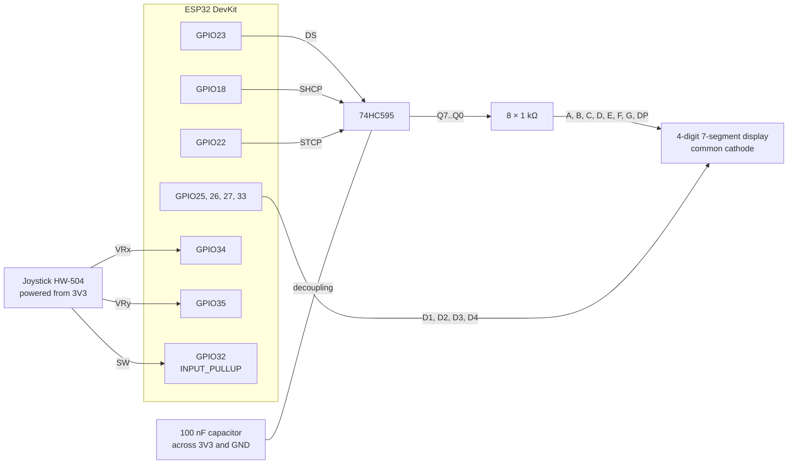
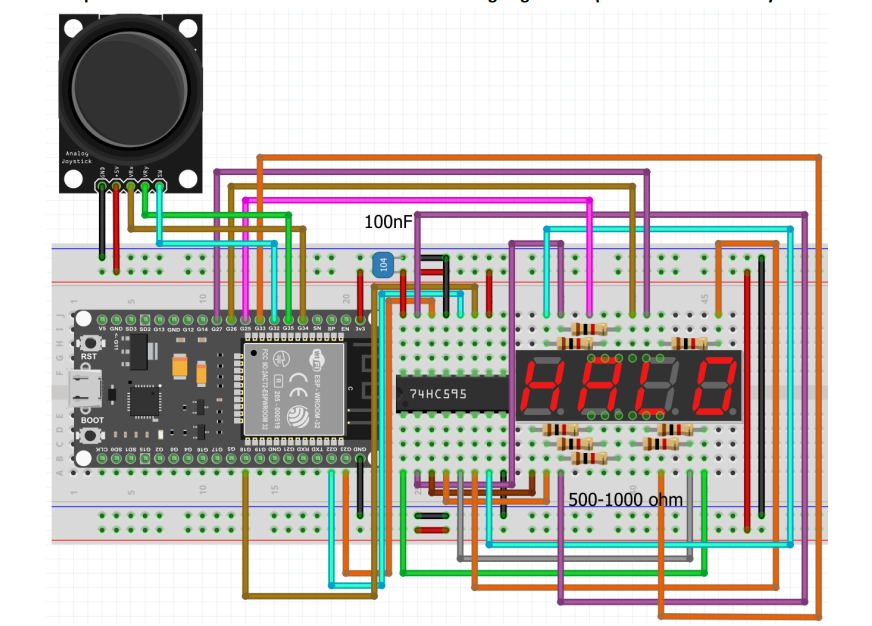
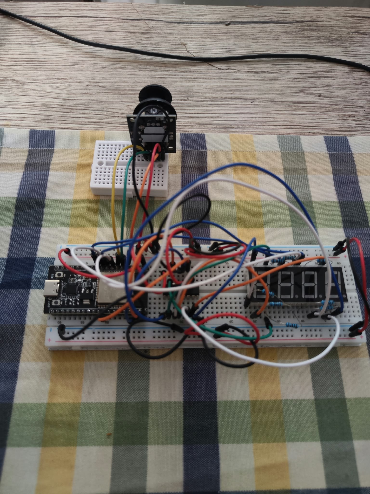
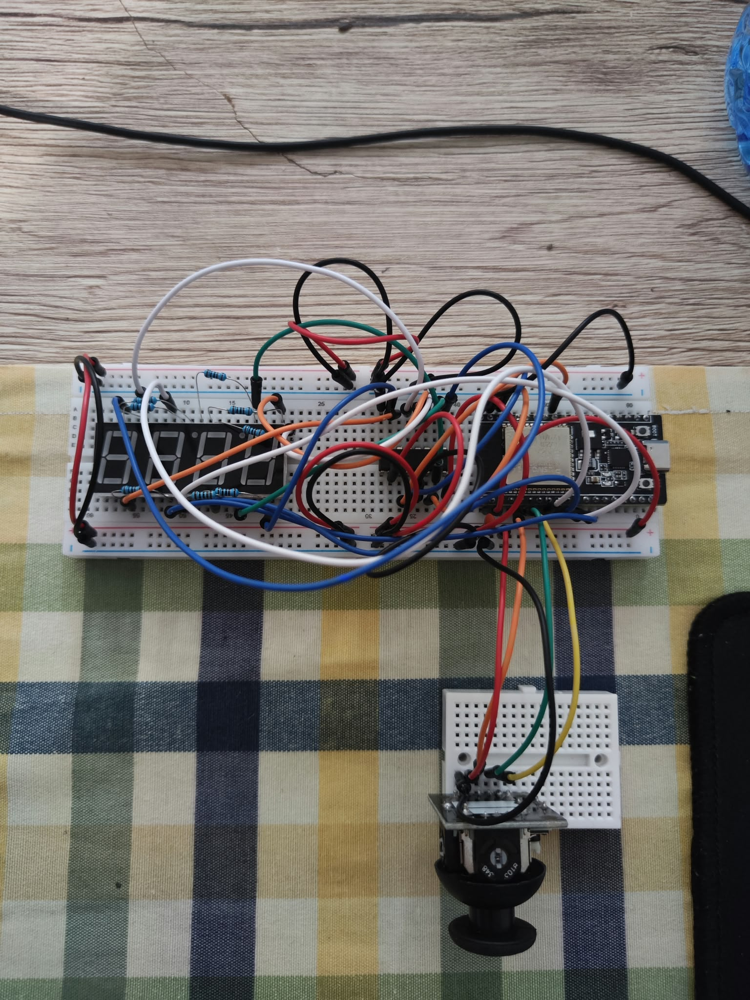
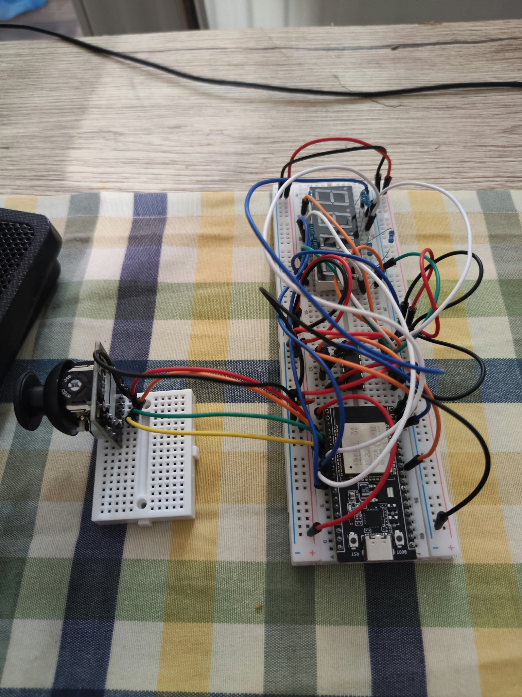
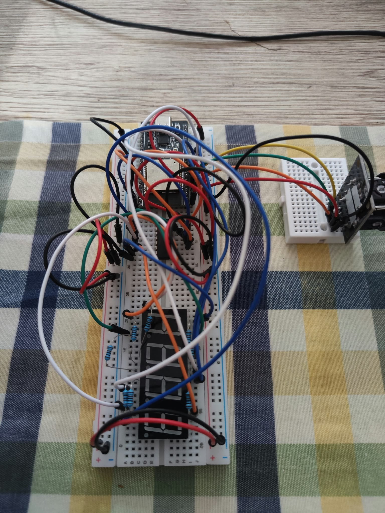
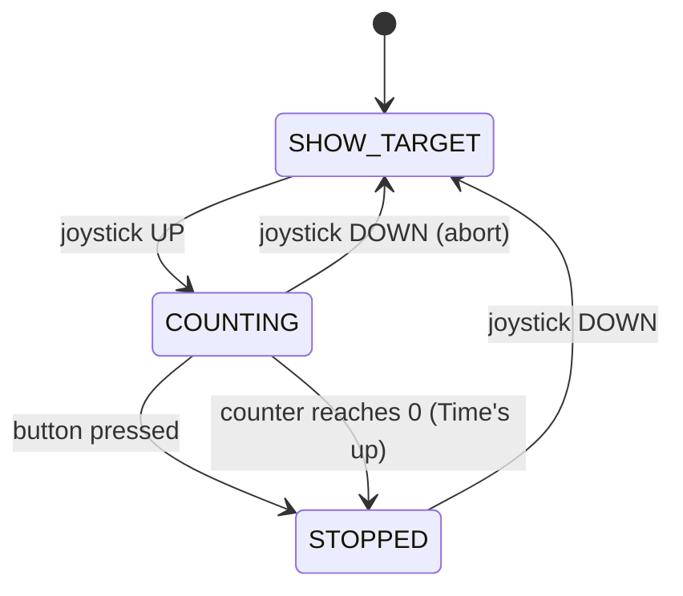
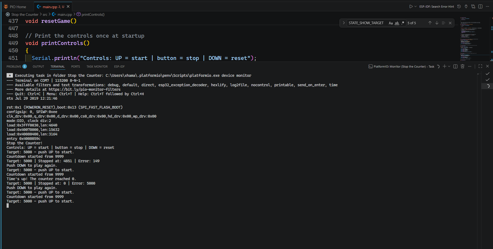

# Homework 5 – Stop the Counter!

[⬅ Back to all homeworks](../README.md)

A number races down from 9999. Can you stop it right on the target?

In this homework I built a small **reaction game** with an ESP32, a **74HC595 shift register**, a **4-digit 7-segment display** and an **analog joystick**. The display shows a target number, **5000**. When I push the joystick **UP**, a counter starts falling from **9999**, one unit every millisecond. I press the joystick **button** when I think it's as close to 5000 as possible. The display freezes on the number I stopped at, and the Serial Monitor tells me how far off I was. Pushing **DOWN** brings the target back for another round. If nobody stops the counter, it stops on its own at **0**.

The 7-segment display is driven through the shift register, so the 8 segment lines need only 3 ESP32 pins. The four digits share those lines and are lit one after another so fast that all four look like they're on at the same time. Every segment pattern is a single byte, built and sent bit by bit with bit operations. No `delay()` is used anywhere, so the display never stops refreshing.

| At a glance | |
|---|---|
| Board / framework | ESP32 DevKit (ESP32-WROOM-32), Arduino framework, PlatformIO |
| Display | 74HC595 shift register + 4-digit 7-segment display (common cathode) |
| Input | Analog joystick: VRx on `GPIO34`, VRy on `GPIO35`, button (SW) on `GPIO32` |
| Key concepts | Shift register, multiplexing, bit masks (`uint8_t`, `>>`, `&`, `~`), leading-zero blanking, dead zone + hysteresis, edge detection, debouncing, state machine, non-blocking timing with `millis()` |
| Code | [`Stop the Counter/src/main.cpp`](Stop%20the%20Counter/src/main.cpp) |
| Demo video | [▶ YouTube](https://youtube.com/shorts/pVg0Hy-p8P0) |

## Bonuses

| Bonus | Status | How to enable / where in code |
|---|---|---|
| No bonuses in this version yet (coming in a separate update) | – | – |

## Contents

- [Bonuses](#bonuses)
- [Files in this folder](#files-in-this-folder)
- [Demo video](#demo-video)
- [Controls](#controls)
- [Hardware and wiring](#hardware-and-wiring)
- [Calculations](#calculations)
- [How it works](#how-it-works)
- [Requirements checklist](#requirements-checklist)
- [Key design decisions](#key-design-decisions)
- [Theory vs. practice](#theory-vs-practice)
- [Problems I ran into](#problems-i-ran-into)
- [How I tested the circuit first](#how-i-tested-the-circuit-first)
- [Serial Monitor](#serial-monitor)
- [How to build and upload](#how-to-build-and-upload)
- [Acknowledgments](#acknowledgments)

## Files in this folder

| File / folder | Content |
|---|---|
| [`Stop the Counter/`](Stop%20the%20Counter/) | PlatformIO project (`platformio.ini`, `src/main.cpp`) |
| [`images/`](images/) | Circuit photos, the Laboratory 4 wiring diagram, Serial Monitor screenshot |

---

## Demo video

<a href="https://youtube.com/shorts/pVg0Hy-p8P0"></a>

The Serial Monitor is visible in the video the whole time. In order, you can see:

1. **The target.** 5000 is on the display before anything starts.
2. **Start.** Pushing the joystick UP starts the countdown from 9999.
3. **Stop.** Pressing the joystick button stops it. The display freezes on the stopped value, and the Serial Monitor prints the target, the stopped value and the error.
4. **Nothing else counts while stopped.** Pressing the button again or pushing UP does nothing.
5. **Reset.** Pushing DOWN brings the target back.
6. **A second round.** Same thing again, with a different result.
7. **Leading zeros.** I let a round run all the way down: 999 → 99 → 9 → 0, with no leading zeros, and the Serial Monitor prints "Time's up!".
8. **Reset again.** DOWN brings back the target.

---

## Controls

| Input | Action | When it works |
|---|---|---|
| Joystick **UP** | Start the countdown from 9999 | Only on the target screen |
| Joystick **button** | Stop the countdown | Only while the counter is running |
| Joystick **DOWN** | Reset: back to the target screen | After a stop, or during a round to abort it |

Everything else is ignored: LEFT and RIGHT, the button outside a round, UP during or after a round, and DOWN on the target screen.

---

## Hardware and wiring

**Components:** ESP32 DevKit (ESP32-WROOM-32), 74HC595 shift register, 4-digit 7-segment display (common cathode), 8 × 1 kΩ resistors (one per segment line A–G and DP), analog joystick module (HW-504), 100 nF decoupling capacitor, breadboard + mini breadboard, jumper wires (female-male for the joystick), USB cable.

I also used the optional **100 nF decoupling capacitor** from the lab, placed on the 3.3 V power rail with one leg in **+** and one in **−**. Its + leg sits in the same hole as the red wire that feeds the 74HC595, so it's right where the chip takes its power. It smooths the small, fast current spikes on the supply each time the outputs switch.

| Component / signal | Connection |
|---|---|
| 74HC595 DS (data) | `GPIO23` |
| 74HC595 SHCP (shift clock) | `GPIO18` |
| 74HC595 STCP (latch) | `GPIO22` |
| 74HC595 VCC | 3V3 |
| 74HC595 GND | GND |
| 100 nF capacitor | across the 3.3 V rail (+ and −), + leg in the same hole as the 74HC595's red supply wire (decoupling) |
| 74HC595 MR (reset, active LOW) | 3V3 (never reset) |
| 74HC595 OE (output enable, active LOW) | GND (outputs always on) |
| 74HC595 Q7S (serial out) | not connected |
| 74HC595 Q7..Q0 | each through 1 kΩ → segments A, B, C, D, E, F, G, DP (bit 7 = A … bit 0 = DP) |
| Digits D1, D2, D3, D4 (common cathodes, D1 = leftmost) | `GPIO25`, `GPIO26`, `GPIO27`, `GPIO33` (LOW = digit on) |
| Joystick VRx | `GPIO34` |
| Joystick VRy | `GPIO35` |
| Joystick SW | `GPIO32` (`INPUT_PULLUP`, pressed = LOW) |
| Joystick +5V / GND | **3V3** / GND |

- The joystick is powered from **3V3, not 5V**. The ESP32 pins are not 5 V tolerant, and at 3.3 V the stick's outputs stay inside the ADC range.
- My breadboard's power rails are **split at row 30**, so I bridged both halves of each rail.

### Wiring diagram





*Wiring diagram from Laboratory 4 (Unibuc Robotics); my circuit follows it exactly.*

### The assembled circuit

The same circuit from four sides:

| Joystick at the top | Joystick at the bottom |
|---|---|
|  |  |
| **Joystick on the left** | **Joystick on the right** |
|  |  |

---

## Calculations

### 1. Current through one segment

Each segment line has its own 1 kΩ resistor. With the 74HC595 output at $V_{CC} = 3.3$ V and a segment LED drop of about $V_F \approx 2.1$ V:

$$I_{seg} = \frac{V_{CC} - V_F}{R} = \frac{3.3\ \text{V} - 2.1\ \text{V}}{1\ \text{k}\Omega} = \frac{1.2\ \text{V}}{1000\ \Omega} = 1.20\ \text{mA}$$

### 2. Worst case on one digit pin

All the segments of a lit digit share the same common cathode, so all their current flows into **one** ESP32 pin. The worst case is "8." (all 7 segments + DP):

$$I_{digit} = N \cdot I_{seg} = 8 \cdot 1.20\ \text{mA} = 9.60\ \text{mA} < 12\ \text{mA}$$

That stays below the roughly **12 mA** recommended per ESP32 pin. ✅

### 3. The smallest safe resistor

How small could the resistors be before a digit pin goes over 12 mA?

$$R_{min} = \frac{N \cdot (V_{CC} - V_F)}{I_{max}} = \frac{8 \cdot 1.2\ \text{V}}{12\ \text{mA}} = \frac{9.6\ \text{V}}{0.012\ \text{A}} = 800.00\ \Omega$$

So something like 600 Ω would be too small ($8 \cdot 1.2\ \text{V} / 600\ \Omega = 16.00$ mA on one pin). 1 kΩ is above 800 Ω and leaves a safety margin.

### 4. Multiplexing

One digit is lit at a time, for $t_{digit} = 2$ ms (`refreshIntervalMs`), and there are $n = 4$ digits:

$$T_{cycle} = n \cdot t_{digit} = 4 \cdot 2\ \text{ms} = 8.00\ \text{ms} \qquad f = \frac{1}{T_{cycle}} = \frac{1}{0.008\ \text{s}} = 125.00\ \text{Hz} \qquad D = \frac{1}{n} = 25.00\ \%$$

Every digit lights up 125 times per second, well above the ~50–60 Hz where the eye starts to see flicker. So there's no visible flicker.

### 5. Countdown timing

The counter drops by 1 every $t_{step} = 1$ ms (`countdownStepMs`):

$$t_{target} = (9999 - 5000) \cdot 1\ \text{ms} = 4999\ \text{ms} \approx 5.00\ \text{s} \qquad t_{zero} = 9999 \cdot 1\ \text{ms} = 9999\ \text{ms} \approx 10.00\ \text{s}$$

About 5 seconds to reach the target, inside the 3–10 s the game should take to be playable.

### 6. Joystick thresholds

The ADC is 12-bit (0–4095). I measured the center at about **X = 1950** and **Y = 1925**. A move counts once the stick is **1200** away from the center (`joystickTriggerThreshold`). It counts as centered again only when both axes are closer than **600** (`joystickDeadZone`).

| | X (center 1950) | Y (center 1925) |
|---|---|---|
| Trigger, toward 0 | $\dfrac{1200}{1950} = 61.54\ \%$ of the travel | $\dfrac{1200}{1925} = 62.34\ \%$ of the travel |
| Trigger, toward 4095 | $\dfrac{1200}{4095 - 1950} = \dfrac{1200}{2145} = 55.94\ \%$ | $\dfrac{1200}{4095 - 1925} = \dfrac{1200}{2170} = 55.30\ \%$ |
| Dead zone, toward 0 | $\dfrac{600}{1950} = 30.77\ \%$ | $\dfrac{600}{1925} = 31.17\ \%$ |

So the stick has to be pushed clearly past halfway to count, and it has to come back to within about a third of the travel before the next push is accepted.

### 7. Timing summary

| What | Value in code | Meaning |
|---|---|---|
| Digit refresh | `refreshIntervalMs = 2` | 2 ms per digit, 8 ms for all four, 125 Hz |
| Joystick reading | `joystickReadIntervalMs = 10` | read every 10 ms (100 times per second) |
| Button debounce | `debounceDelayMs = 30` | 0.03 s of stable reading before a press counts |
| Countdown step | `countdownStepMs = 1` | 1 unit per ms, 1000 units per second |

---

## How it works

The full code is in [`Stop the Counter/src/main.cpp`](Stop%20the%20Counter/src/main.cpp). `loop()` reads the time once and passes it to four independent jobs. None of them waits, and each one returns right away if it has nothing to do:

```cpp
void loop()
{
  unsigned long currentTime = millis();
  updateButton(currentTime);
  updateJoystick(currentTime);
  updateCountdown(currentTime);
  refreshDisplay(currentTime);
}
```

### Sending a byte to the 74HC595

`writeReg()` sends one segment pattern to the shift register, bit by bit, **most significant bit first** (bit 7 = segment A):

```cpp
for (int i = 7; i >= 0; i--)
{
  uint8_t bit = (pattern >> i) & 0x01;
  digitalWrite(clockPin, LOW);
  digitalWrite(dataPin, bit);
  digitalWrite(clockPin, HIGH);
  digitalWrite(clockPin, LOW);
}
digitalWrite(latchPin, HIGH);
```

- `(pattern >> i) & 0x01` moves bit `i` down to position 0 and masks everything else away, so only that one bit is left.
- Each rising edge of SHCP pushes one bit in. While that happens the outputs don't change. They only update when STCP (the **latch**) goes HIGH, and then **all 8 outputs change together**, so you never see a half-shifted pattern.
- A common-anode display would need the opposite levels, so `writeReg()` flips every bit with `~` when `COMMON_ANODE` is `true`. My display is common cathode, so the pattern goes out as it is.

The digit patterns are plain bytes in the order **A B C D E F G DP**:

```cpp
const uint8_t byteEncodings[10] = {
  0b11111100, // 0
  0b01100000, // 1
  ...
  0b11110110  // 9
};
```

### Multiplexing: `displayBuffer` + `refreshDisplay()`

The display only ever shows what's in `displayBuffer[4]`, one segment pattern per digit. The game logic writes to the buffer, and `refreshDisplay()` is the only function that touches the hardware. Every 2 ms it moves to the next digit:

```cpp
turnOffAllDigits();
writeReg(displayBuffer[currentDigit]);
digitalWrite(displayDigits[currentDigit], DIGIT_ON);
currentDigit = (currentDigit + 1) % displayCount;
```

All digits are switched **off before** the new pattern is written. Otherwise the new pattern would show for a moment on the old digit, giving faint "ghost" segments.

### Leading zeros: `setDisplayNumber()`

Digits are taken from the right with `% 10` (the last digit) and `/ 10` (drop the last digit). Once nothing is left of the number, the remaining positions on the left are leading zeros and get `blankPattern` instead. The **units** position is always drawn, so 0 still shows as "0".

Trace for **42**:

| Position (right → left) | `remaining` before | Units position? | Shown | `remaining` after `/ 10` |
|---|---|---|---|---|
| 3 (D4) | 42 | yes | `42 % 10` = **2** | 4 |
| 2 (D3) | 4 | no | `4 % 10` = **4** | 0 |
| 1 (D2) | 0 | no | **blank** | 0 |
| 0 (D1) | 0 | no | **blank** | 0 |

Result: `[blank, blank, 4, 2]`. For **1000**, `remaining` is only 0 after the last position, so the middle zeros stay: `1 0 0 0`. For **0**, only the units position shows "0" and the rest are blank.

### Joystick: dead zone, hysteresis and edge detection

- **Calibration.** `analogRead()` minus the measured center (1950 / 1925) gives an offset around 0.
- **Dominant axis.** `getJoystickDirection()` only looks at the axis that moved the most. A slightly diagonal push still counts as **one** direction, never two.
- **Two thresholds = hysteresis.** A move needs an offset above **1200**, but the stick only counts as back in the center below **600** on both axes. Between the two, nothing changes. It works like a thermostat that turns the heating on at one temperature and off at another, so noise near a single limit can't make it switch back and forth.
- **Edge detection.** When a move fires, `joystickCentered` becomes `false`, and no new move is accepted until the stick comes back to the dead zone. Holding the stick UP starts the game **once**, not on every reading.

### Button: debouncing

The button uses the same stable-state debounce as my Homework 4: every change of the raw reading restarts a timer, and the new state is accepted only after it stays the same for **30 ms**. The action happens on the **press** (HIGH → LOW), not on the release. This is a reaction game, so stopping the counter as soon as the finger goes down is what's fair.

### The game: a state machine



| State | Display | Waiting for |
|---|---|---|
| `STATE_SHOW_TARGET` | the target, 5000 | UP |
| `STATE_COUNTING` | the falling counter | the button (or DOWN to abort) |
| `STATE_STOPPED` | the frozen stopped value | DOWN |

`onJoystickMoved()` and `onButtonPressed()` check the current state before doing anything. That's why inputs that don't make sense in a state are simply ignored.

### The countdown: computed from elapsed time

The counter isn't decreased by 1 on every loop. Instead, `updateCountdown()` works out the value from the time since the start:

```cpp
unsigned long stepsDone = (currentTime - countdownStartTime) / countdownStepMs;
int newValue = countdownStartValue - (int)stepsDone;
```

$$value = 9999 - \frac{t_{now} - t_{start}}{1\ \text{ms}}$$

If a loop is ever slow, a number may be skipped, but the game **never runs slower** than 1 unit per ms. The buffer is only rewritten when the value actually changes. When `stepsDone` reaches 9999, the counter is set to 0, "Time's up!" is printed and the round stops by itself.

The error is computed with `int` and `abs()`:

```cpp
int error = abs(counterValue - targetNumber);
```

If these were `unsigned`, stopping at 4813 would give $4813 - 5000$, which **wraps around** to a huge positive number instead of −187.

---

## Requirements checklist

| # | Requirement | Where in the code |
|---|---|---|
| 1 | Target number visible at startup | `defaultTargetNumber = 5000`; `setup()` calls `resetGame()`, which shows it |
| 2 | Countdown from a higher value, playable speed, auto-stop at 0 | `startCountdown()`, `updateCountdown()` (`countdownStartValue = 9999`, `countdownStepMs = 1`, stop when `stepsDone >= 9999`) |
| 3 | Stop, freeze, error = \|stopped − target\| on Serial | `onButtonPressed()` → `stopCountdown()`; the display buffer isn't touched in `STATE_STOPPED` |
| 4 | Reset/replay; dead zone, edge detection, debouncing | `onJoystickMoved()` → `resetGame()`; `updateJoystick()` (`joystickDeadZone`, `joystickCentered`), `updateButton()` (`debounceDelayMs`) |
| 5 | No leading zeros, 0 shown as "0" | `setDisplayNumber()` (`blankPattern`, `isUnitsPosition`) |
| 6 | Bitwise display control, `uint8_t` patterns, no display library | `byteEncodings[]`, `displayBuffer[]`, `writeReg()` (`>>`, `& 0x01`, `~`) |
| 7 | Non-blocking, display always refreshed | `loop()` + `millis()` everywhere, no `delay()`; `refreshDisplay()` runs on every loop |
| 8 | Video | [Demo video](#demo-video) |

---

## Key design decisions

- **The countdown is computed from elapsed time**, not counted loop by loop, so its speed doesn't depend on how fast `loop()` runs.
- **Display logic separated from game logic.** The game only writes numbers into `displayBuffer`, and only `refreshDisplay()` drives the pins. The countdown never has to care about multiplexing.
- **Act on the button press, not the release.** In a reaction game, the moment the finger goes down is the answer.
- **Dominant axis + two thresholds + edge detection** for the joystick: one clean action per push, even with a diagonal push or a noisy stick.
- **The state decides which input counts.** Every action checks `gameState` first, so a stray press or push can't break a round.
- **DOWN also aborts a running round**, so you don't have to wait 10 seconds after a bad start.
- **One `currentTime` per loop**, and time comparisons by subtraction (`currentTime - last >= interval`), which keeps working even when `millis()` overflows.
- **`COMMON_ANODE` switch.** The same code works for both display types: the digit levels and the `~` inversion follow this one constant.

---

## Theory vs. practice

| Test | What theory says | What I saw |
|---|---|---|
| Joystick center | 2048 (middle of 0–4095) | X about **1945–1954**, Y about **1920–1931**, with ±5–10 of noise at rest. Pressing the button moves the stick a little (up to about ±40), far inside the dead zone |
| Axis direction | – | X grows to the right, but **Y is inverted**: pushing UP gives 0, pushing DOWN gives 4095 |
| Independent axes | Pushing one axis leaves the other at the center | Pushing one axis hard **moved the other too**: X dropped to about 770 while I pushed DOWN. That's why I added the dominant-axis rule |
| Brightness | Each digit is on 25 % of the time, so a quarter of full brightness | It looks **brighter than a quarter**. The eye doesn't perceive brightness linearly (the same effect as DIM in Homework 4) |
| Reaction | A perfect stop has error 0 | My real results were errors of **187** and **32** (stopped at 4813 and 4968). The press is confirmed about 30 ms after the contact settles (debounce), about 30 counter units at 1 unit/ms. That's small compared with human reaction time (~200 ms) |

---

## Problems I ran into

- **The joystick's axes were swapped.** At first I mounted the joystick standing up on the mini breadboard, so its X axis was vertical. *Fix:* I mounted it flat with female-male wires and ran the diagnostic program again to re-map the directions.
- **Garbage characters in the Serial Monitor.** Once, a few random characters appeared. It was a USB glitch: the board didn't reset and nothing else went wrong.
- **"Could not open COMx, the port is busy".** The Serial Monitor was still holding the port. *Fix:* close the monitor before uploading.
- **IntelliSense: "#include errors detected".** Only the editor was confused. The project built and uploaded fine.

---

## How I tested the circuit first

Before writing the game, I ran a separate **diagnostic program**. It lit every segment on every digit one by one (to check the wiring and the bit order), showed `1234` and `8.8.8.8.`, and printed the joystick's minimum and maximum values to the Serial Monitor. The calibration numbers in the game (the 1950 / 1925 centers and the axis directions) come from there. The diagnostic program isn't included as a file.

---

## Serial Monitor

Two rounds with their target, stopped value and error, a round that ran down to 0 ("Time's up!") and a reset:



## How to build and upload

1. Open `Homework 5/Stop the Counter` in **VS Code** with the **PlatformIO** extension.
2. **Close the Serial Monitor** if it's open (otherwise the port is busy).
3. Click **Upload and Monitor**. The monitor runs at **115200 baud** (`monitor_speed = 115200` in [`platformio.ini`](Stop%20the%20Counter/platformio.ini)).
4. If the upload hangs at `Connecting...`, hold the **BOOT** button on the ESP32 until it starts writing.

---

## Acknowledgments

I used Claude (Anthropic) as a tutor for this homework. It checked my calculations, gave me a diagnostic program to test the circuit and the base code. I then wrote the game logic myself step by step with its guidance and corrections; the submitted `main.cpp` is a cleaned-up version that Claude reviewed, with the same logic as mine. Claude Code drafted this README from my notes, and I read and checked it.

- The `writeReg()` function, the `byteEncodings` table, the joystick reading and the Fritzing wiring diagram are based on the **Laboratory 4** examples.
- The button debouncing comes from my **Homework 4** code.

[⬅ Back to all homeworks](../README.md)
